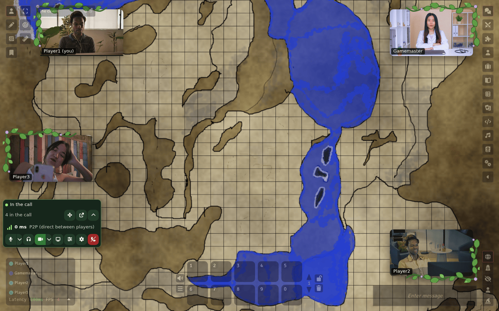
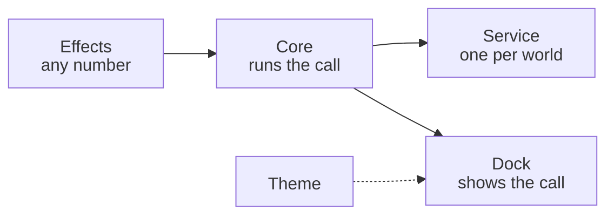

# Modular A/V

Voice and video for Foundry VTT (v14+), built from modules you pick: a
core, the service your table talks through, the look of the camera dock,
and effects for your microphone and camera. It reconnects by itself,
never shows a state it isn't in (a mute that isn't applied, a blur that
isn't running), and keeps your server's secret away from players.



The user guide is the **[wiki](https://github.com/Affid/modular-av/wiki)**:
[getting started](https://github.com/Affid/modular-av/wiki/Getting-Started),
[choosing a service](https://github.com/Affid/modular-av/wiki/Choosing-a-Service),
[troubleshooting](https://github.com/Affid/modular-av/wiki/Troubleshooting).

## Quick start

1. In Foundry's Setup screen, open **Add-on Modules**, **Install Module**
   and paste the starter set's manifest URL:

   ```
   https://raw.githubusercontent.com/Affid/modular-av/manifests/modular-av-starter-set/module.json
   ```

   It brings the core, the dock, LiveKit and noise cancellation, and
   offers the camera background.

2. Launch your world and enable **Modular A/V: Starter set**.
3. Enter your LiveKit server's address, key and secret
   ([how](https://github.com/Affid/modular-av/wiki/LiveKit)).

No server? Skip the starter set and install `modular-av-dock` and
`modular-av-p2p` (their URLs are [below](#modules)): players' browsers
talk directly, for up to about six players.

Coming from LiveKit AVClient? Your server and each player's choices come
along: see [Moving from LiveKit AVClient](https://github.com/Affid/modular-av/wiki/Moving-from-LiveKit-AVClient).

## How it fits together



Every module needs the core. A world takes one service, and may add the
dock, a theme for it and any number of effects. Once the core is in a
world, a GM can open **Plan your modules** in its settings: it shows
every module, which ones the world runs, and gives the links for the
rest.

## Which service?

|            | P2P                   | LiveKit                     | Jitsi                      |
| ---------- | --------------------- | --------------------------- | -------------------------- |
| Server     | None                  | LiveKit Cloud or your own   | Your own Jitsi Meet        |
| Table size | Up to about 6 players | Any size                    | What your server handles   |
| You set    | Nothing               | Address, API key and secret | Address, app id and secret |

## Modules

Each module installs on its own. Its manifest URL is this, with the
module's id in place of `<id>`:

```
https://raw.githubusercontent.com/Affid/modular-av/manifests/<id>/module.json
```

| Kind    | Module id                                                        | What it does                                                           |
| ------- | ---------------------------------------------------------------- | ---------------------------------------------------------------------- |
| Core    | [`modular-av`](packages/core/README.md)                          | Needed by all the others                                               |
| Service | [`modular-av-p2p`](packages/p2p/README.md)                       | Calls directly between players' browsers, no server                    |
| Service | [`modular-av-livekit`](packages/livekit/README.md)               | Calls over your LiveKit server or LiveKit Cloud                        |
| Service | [`modular-av-jitsi`](packages/jitsi/README.md)                   | Calls over your own Jitsi Meet server (with token authentication)      |
| Cameras | [`modular-av-dock`](packages/dock/README.md)                     | The camera dock, voice panel and settings window                       |
| Theme   | [`modular-av-dock-vines`](packages/dock-vines/README.md)         | Vine leaves around the cameras                                         |
| Effect  | [`modular-av-mic-denoise`](packages/mic-denoise/README.md)       | Noise cancellation in your browser: RNNoise, Speex or GTCRN            |
| Effect  | [`modular-av-cam-background`](packages/cam-background/README.md) | Blurs or replaces your camera's background, in your browser            |
| Effect  | [`modular-av-audio-reverb`](packages/audio-reverb/README.md)     | A reverb for the voice                                                 |
| Effect  | [`modular-av-audio-echo`](packages/audio-echo/README.md)         | An echo for the voice                                                  |
| Effect  | [`modular-av-audio-eq`](packages/audio-eq/README.md)             | A three band equalizer for the voice                                   |
| Effect  | [`modular-av-audio-radio`](packages/audio-radio/README.md)       | A walkie-talkie for the voice: static and squelch                      |
| Effect  | [`modular-av-audio-boost`](packages/audio-boost/README.md)       | Raises a quiet microphone and evens out its peaks                      |
| Mixer   | [`modular-av-audio-mixer`](packages/audio-mixer/README.md)       | A window for your voice's effects: order, levels, presets, a GM's view |
| Set     | [`modular-av-starter-set`](packages/starter-set/README.md)       | No code: one install for the usual setup                               |

`modular-av-livekit-krisp` (Krisp on LiveKit Cloud) is held back from
releases for now; see its [README](packages/livekit-krisp/README.md).

## Browsers

Chrome, Edge and other Chromium browsers run everything. Firefox and
Safari aren't tested yet; there the camera background isn't offered and
the dock's window can't stay always on top (a normal window of its own
works).

## Privacy and security

- Your LiveKit API secret, or your Jitsi app secret, stays in the GM's
  browser. Players get short-lived tokens, signed for them alone, from a
  GM's browser.
- Mute applies to what is sent, in every state of the connection.
- A camera background that isn't running keeps your camera off: it is
  never sent without it.
- Noise cancellation and camera backgrounds run in your browser; no audio
  or video goes anywhere for them. Their files come with the modules.
- A GM's browser asks GitHub for the list of modules when "Plan your
  modules" opens and at most once a day (a world setting turns it off);
  see the [core's page](packages/core/README.md).

## For developers

Start with [docs/ARCHITECTURE.md](docs/ARCHITECTURE.md): how the core,
services, effects and UIs fit together, in ten minutes. The other
documents are listed in [docs/](docs/README.md).

Each directory in `packages/` is one module: `packages/livekit` is
`@modular-av/livekit` on npm and `modular-av-livekit` in Foundry
(`packages/core` is plain `modular-av`). `api`, `kit` and `testing` are
libraries with no Foundry id.

Requires Node 22.18+ and pnpm.

```bash
pnpm install
pnpm verify        # everything CI would run, locally
pnpm test          # unit tests (Vitest)
pnpm test:browser  # browser tests (Playwright, fake devices; noise models in the "effects" project)
pnpm test:services # service contracts: LiveKit, coturn (P2P) and Jitsi in Docker
pnpm test:foundry  # end to end in the local Foundry world
pnpm bench:camera  # camera background measurements (not part of verify)
pnpm build         # each module into packages/<dir>/dist
```

Local Foundry and Chrome: [docs/LOCAL-SETUP.md](docs/LOCAL-SETUP.md).
Releases: [docs/RELEASING.md](docs/RELEASING.md).

## Licence

MIT, see [LICENSE](LICENSE). Contains no code under the Hippocratic License;
third-party code is listed in [THIRD-PARTY-NOTICES.md](THIRD-PARTY-NOTICES.md)
and in each module's own notices.
