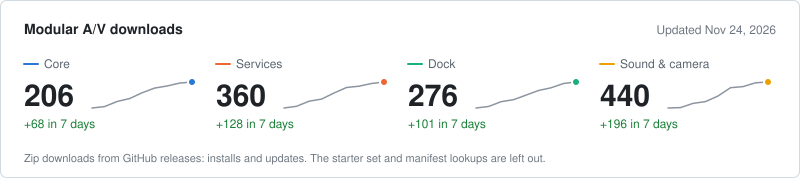
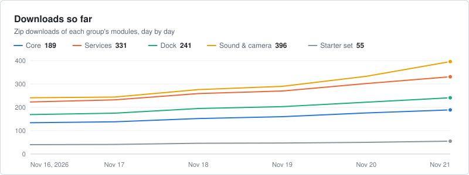
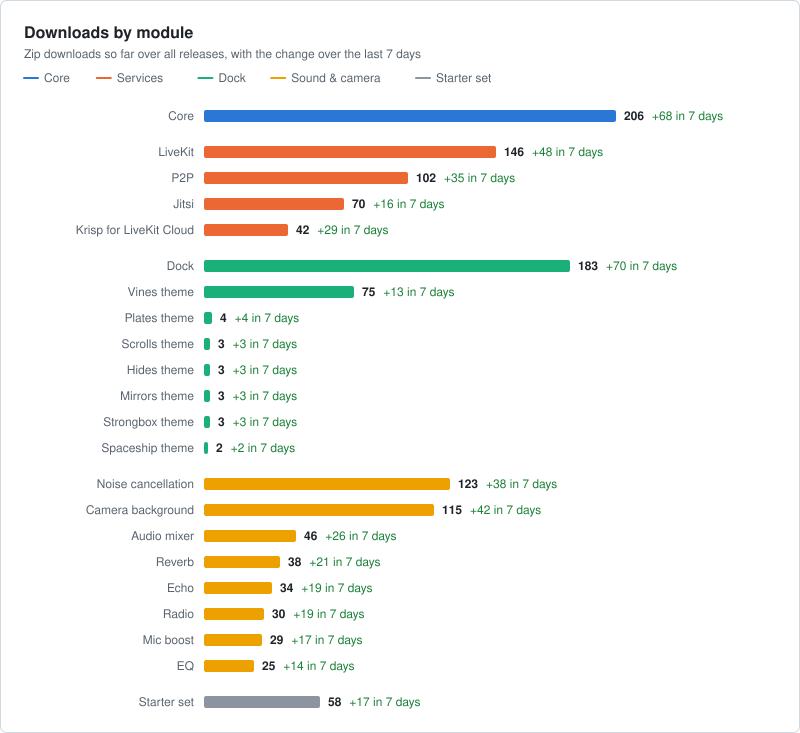

# Modular A/V download counts

Written once a day by the Download counts workflow (`.github/workflows/stats.yml` on `main`). Last snapshot: Nov 22, 2026. Do not edit by hand: the next run replaces this file, the charts and the badges.

<picture>
  <source media="(prefers-color-scheme: dark)" srcset="https://raw.githubusercontent.com/Affid/modular-av/stats/card-dark.svg">
  
</picture>

<picture>
  <source media="(prefers-color-scheme: dark)" srcset="https://raw.githubusercontent.com/Affid/modular-av/stats/downloads-dark.svg">
  
</picture>

<picture>
  <source media="(prefers-color-scheme: dark)" srcset="https://raw.githubusercontent.com/Affid/modular-av/stats/modules-dark.svg">
  
</picture>

<picture>
  <source media="(prefers-color-scheme: dark)" srcset="https://raw.githubusercontent.com/Affid/modular-av/stats/traffic-dark.svg">
  
</picture>

## Modules

| Module | Group | Downloads so far | Change | Latest release |
| --- | --- | ---: | --- | --- |
| Core | Core | 195 | +61 since Nov 16 | 0.16.0: 15 |
| LiveKit | Services | 138 | +44 since Nov 16 | 0.16.0: 10 |
| P2P | Services | 93 | +26 since Nov 16 | 0.16.0: 6 |
| Jitsi | Services | 68 | +15 since Nov 16 | 0.16.0: 5 |
| Krisp for LiveKit Cloud | Services | 39 | +30 since Nov 16 | 0.16.0: 7 |
| Dock | Dock | 171 | +64 since Nov 16 | 0.16.0: 15 |
| Vines theme | Dock | 74 | +12 since Nov 16 | 0.16.0: 3 |
| Plates theme | Dock | 3 | +3 since Nov 16 | 0.16.0: 3 |
| Scrolls theme | Dock | 2 | +2 since Nov 16 | 0.16.0: 2 |
| Hides theme | Dock | 2 | +2 since Nov 16 | 0.16.0: 2 |
| Noise cancellation | Sound & camera | 118 | +34 since Nov 16 | 0.16.0: 8 |
| Camera background | Sound & camera | 108 | +36 since Nov 16 | 0.16.0: 7 |
| Audio mixer | Sound & camera | 42 | +22 since Nov 16 | 0.16.0: 8 |
| Reverb | Sound & camera | 33 | +16 since Nov 16 | 0.16.0: 6 |
| Echo | Sound & camera | 30 | +15 since Nov 16 | 0.16.0: 6 |
| Mic boost | Sound & camera | 27 | +16 since Nov 16 | 0.16.0: 7 |
| Radio | Sound & camera | 25 | +14 since Nov 16 | 0.16.0: 6 |
| EQ | Sound & camera | 22 | +11 since Nov 16 | 0.16.0: 6 |
| Starter set | Starter set | 56 | +16 since Nov 16 | 0.16.0: 4 |

## What is counted

Each module's count is the downloads of its zip over all its releases: Foundry installing or updating it. An update of the whole set downloads every installed module again, so these are downloads, not people.

- **Core**: Foundry installing or updating the core. Every other module requires it, so this is the closest count of how many setups there are, updates included.
- **Services**: The modules that carry the call: LiveKit, P2P, Jitsi, and Krisp for LiveKit Cloud.
- **Dock**: The camera dock and its themes.
- **Sound & camera**: Noise cancellation, the camera background, the audio mixer and the sound effects.
- **Starter set**: Installs through the quick start. Each one also downloads the core, the dock, LiveKit and noise cancellation, which count under those modules, so it isn't on the card.
- **Manifest lookups** (`module.json` in each release, in the table of files only): Foundry and foundryvtt.com reading a release's manifest, mostly for the modules listed there. These are lookups, not installs.
- **Not counted**: the `dev` prerelease, which is rebuilt with every development build, so its counts start over. Manifest URLs on the `manifests` branch have no counter either; the zip download that follows them is counted.

<details>
<summary>Every release file</summary>

| Release | File | Downloads |
| --- | --- | ---: |
| dev | modular-av-dock.json | 3 |
| dev | modular-av-dock.zip | 2 |
| dev | modular-av-livekit-krisp.json | 3 |
| dev | modular-av-livekit-krisp.zip | 2 |
| dev | modular-av-livekit.json | 1 |
| dev | modular-av-livekit.zip | 1 |
| dev | modular-av.json | 1 |
| dev | modular-av.zip | 1 |
| modular-av-audio-boost-v0.12.0 | modular-av-audio-boost.zip | 2 |
| modular-av-audio-boost-v0.12.0 | module.json | 1 |
| modular-av-audio-boost-v0.13.0 | modular-av-audio-boost.zip | 1 |
| modular-av-audio-boost-v0.13.0 | module.json | 2 |
| modular-av-audio-boost-v0.13.1 | modular-av-audio-boost.zip | 1 |
| modular-av-audio-boost-v0.13.1 | module.json | 2 |
| modular-av-audio-boost-v0.13.2 | modular-av-audio-boost.zip | 8 |
| modular-av-audio-boost-v0.13.2 | module.json | 3 |
| modular-av-audio-boost-v0.14.0 | modular-av-audio-boost.zip | 1 |
| modular-av-audio-boost-v0.14.0 | module.json | 3 |
| modular-av-audio-boost-v0.14.1 | modular-av-audio-boost.zip | 3 |
| modular-av-audio-boost-v0.14.1 | module.json | 3 |
| modular-av-audio-boost-v0.15.0 | modular-av-audio-boost.zip | 4 |
| modular-av-audio-boost-v0.15.0 | module.json | 19 |
| modular-av-audio-boost-v0.16.0 | modular-av-audio-boost.zip | 7 |
| modular-av-audio-boost-v0.16.0 | module.json | 47 |
| modular-av-audio-echo-v0.10.0 | modular-av-audio-echo.zip | 2 |
| modular-av-audio-echo-v0.10.0 | module.json | 1 |
| modular-av-audio-echo-v0.10.1 | modular-av-audio-echo.zip | 2 |
| modular-av-audio-echo-v0.10.1 | module.json | 1 |
| modular-av-audio-echo-v0.11.0 | modular-av-audio-echo.zip | 3 |
| modular-av-audio-echo-v0.11.0 | module.json | 1 |
| modular-av-audio-echo-v0.12.0 | modular-av-audio-echo.zip | 3 |
| modular-av-audio-echo-v0.12.0 | module.json | 1 |
| modular-av-audio-echo-v0.13.0 | modular-av-audio-echo.zip | 1 |
| modular-av-audio-echo-v0.13.0 | module.json | 2 |
| modular-av-audio-echo-v0.13.1 | modular-av-audio-echo.zip | 1 |
| modular-av-audio-echo-v0.13.1 | module.json | 2 |
| modular-av-audio-echo-v0.13.2 | modular-av-audio-echo.zip | 3 |
| modular-av-audio-echo-v0.13.2 | module.json | 3 |
| modular-av-audio-echo-v0.14.0 | modular-av-audio-echo.zip | 1 |
| modular-av-audio-echo-v0.14.0 | module.json | 3 |
| modular-av-audio-echo-v0.14.1 | modular-av-audio-echo.zip | 3 |
| modular-av-audio-echo-v0.14.1 | module.json | 3 |
| modular-av-audio-echo-v0.15.0 | modular-av-audio-echo.zip | 5 |
| modular-av-audio-echo-v0.15.0 | module.json | 23 |
| modular-av-audio-echo-v0.16.0 | modular-av-audio-echo.zip | 6 |
| modular-av-audio-echo-v0.16.0 | module.json | 48 |
| modular-av-audio-eq-v0.10.0 | modular-av-audio-eq.zip | 1 |
| modular-av-audio-eq-v0.10.0 | module.json | 1 |
| modular-av-audio-eq-v0.10.1 | modular-av-audio-eq.zip | 2 |
| modular-av-audio-eq-v0.10.1 | module.json | 1 |
| modular-av-audio-eq-v0.11.0 | modular-av-audio-eq.zip | 2 |
| modular-av-audio-eq-v0.11.0 | module.json | 1 |
| modular-av-audio-eq-v0.12.0 | modular-av-audio-eq.zip | 1 |
| modular-av-audio-eq-v0.12.0 | module.json | 1 |
| modular-av-audio-eq-v0.13.0 | modular-av-audio-eq.zip | 1 |
| modular-av-audio-eq-v0.13.0 | module.json | 2 |
| modular-av-audio-eq-v0.13.1 | modular-av-audio-eq.zip | 1 |
| modular-av-audio-eq-v0.13.1 | module.json | 2 |
| modular-av-audio-eq-v0.13.2 | modular-av-audio-eq.zip | 3 |
| modular-av-audio-eq-v0.13.2 | module.json | 3 |
| modular-av-audio-eq-v0.14.0 | modular-av-audio-eq.zip | 1 |
| modular-av-audio-eq-v0.14.0 | module.json | 3 |
| modular-av-audio-eq-v0.14.1 | modular-av-audio-eq.zip | 1 |
| modular-av-audio-eq-v0.14.1 | module.json | 3 |
| modular-av-audio-eq-v0.15.0 | modular-av-audio-eq.zip | 3 |
| modular-av-audio-eq-v0.15.0 | module.json | 19 |
| modular-av-audio-eq-v0.16.0 | modular-av-audio-eq.zip | 6 |
| modular-av-audio-eq-v0.16.0 | module.json | 47 |
| modular-av-audio-mixer-v0.10.0 | modular-av-audio-mixer.zip | 2 |
| modular-av-audio-mixer-v0.10.0 | module.json | 1 |
| modular-av-audio-mixer-v0.10.1 | modular-av-audio-mixer.zip | 3 |
| modular-av-audio-mixer-v0.10.1 | module.json | 1 |
| modular-av-audio-mixer-v0.11.0 | modular-av-audio-mixer.zip | 4 |
| modular-av-audio-mixer-v0.11.0 | module.json | 1 |
| modular-av-audio-mixer-v0.12.0 | modular-av-audio-mixer.zip | 3 |
| modular-av-audio-mixer-v0.12.0 | module.json | 2 |
| modular-av-audio-mixer-v0.13.0 | modular-av-audio-mixer.zip | 1 |
| modular-av-audio-mixer-v0.13.0 | module.json | 3 |
| modular-av-audio-mixer-v0.13.1 | modular-av-audio-mixer.zip | 1 |
| modular-av-audio-mixer-v0.13.1 | module.json | 3 |
| modular-av-audio-mixer-v0.13.2 | modular-av-audio-mixer.zip | 6 |
| modular-av-audio-mixer-v0.13.2 | module.json | 4 |
| modular-av-audio-mixer-v0.14.0 | modular-av-audio-mixer.zip | 1 |
| modular-av-audio-mixer-v0.14.0 | module.json | 4 |
| modular-av-audio-mixer-v0.14.1 | modular-av-audio-mixer.zip | 6 |
| modular-av-audio-mixer-v0.14.1 | module.json | 24 |
| modular-av-audio-mixer-v0.15.0 | modular-av-audio-mixer.zip | 7 |
| modular-av-audio-mixer-v0.15.0 | module.json | 37 |
| modular-av-audio-mixer-v0.16.0 | modular-av-audio-mixer.zip | 8 |
| modular-av-audio-mixer-v0.16.0 | module.json | 47 |
| modular-av-audio-radio-v0.11.0 | modular-av-audio-radio.zip | 3 |
| modular-av-audio-radio-v0.11.0 | module.json | 1 |
| modular-av-audio-radio-v0.12.0 | modular-av-audio-radio.zip | 3 |
| modular-av-audio-radio-v0.12.0 | module.json | 1 |
| modular-av-audio-radio-v0.13.0 | modular-av-audio-radio.zip | 1 |
| modular-av-audio-radio-v0.13.0 | module.json | 2 |
| modular-av-audio-radio-v0.13.1 | modular-av-audio-radio.zip | 1 |
| modular-av-audio-radio-v0.13.1 | module.json | 2 |
| modular-av-audio-radio-v0.13.2 | modular-av-audio-radio.zip | 3 |
| modular-av-audio-radio-v0.13.2 | module.json | 3 |
| modular-av-audio-radio-v0.14.0 | modular-av-audio-radio.zip | 1 |
| modular-av-audio-radio-v0.14.0 | module.json | 3 |
| modular-av-audio-radio-v0.14.1 | modular-av-audio-radio.zip | 3 |
| modular-av-audio-radio-v0.14.1 | module.json | 4 |
| modular-av-audio-radio-v0.15.0 | modular-av-audio-radio.zip | 4 |
| modular-av-audio-radio-v0.15.0 | module.json | 23 |
| modular-av-audio-radio-v0.16.0 | modular-av-audio-radio.zip | 6 |
| modular-av-audio-radio-v0.16.0 | module.json | 48 |
| modular-av-audio-reverb-v0.10.0 | modular-av-audio-reverb.zip | 2 |
| modular-av-audio-reverb-v0.10.0 | module.json | 1 |
| modular-av-audio-reverb-v0.10.1 | modular-av-audio-reverb.zip | 3 |
| modular-av-audio-reverb-v0.10.1 | module.json | 1 |
| modular-av-audio-reverb-v0.11.0 | modular-av-audio-reverb.zip | 3 |
| modular-av-audio-reverb-v0.11.0 | module.json | 1 |
| modular-av-audio-reverb-v0.12.0 | modular-av-audio-reverb.zip | 3 |
| modular-av-audio-reverb-v0.12.0 | module.json | 1 |
| modular-av-audio-reverb-v0.13.0 | modular-av-audio-reverb.zip | 1 |
| modular-av-audio-reverb-v0.13.0 | module.json | 2 |
| modular-av-audio-reverb-v0.13.1 | modular-av-audio-reverb.zip | 1 |
| modular-av-audio-reverb-v0.13.1 | module.json | 2 |
| modular-av-audio-reverb-v0.13.2 | modular-av-audio-reverb.zip | 4 |
| modular-av-audio-reverb-v0.13.2 | module.json | 3 |
| modular-av-audio-reverb-v0.14.0 | modular-av-audio-reverb.zip | 1 |
| modular-av-audio-reverb-v0.14.0 | module.json | 3 |
| modular-av-audio-reverb-v0.14.1 | modular-av-audio-reverb.zip | 4 |
| modular-av-audio-reverb-v0.14.1 | module.json | 4 |
| modular-av-audio-reverb-v0.15.0 | modular-av-audio-reverb.zip | 5 |
| modular-av-audio-reverb-v0.15.0 | module.json | 23 |
| modular-av-audio-reverb-v0.16.0 | modular-av-audio-reverb.zip | 6 |
| modular-av-audio-reverb-v0.16.0 | module.json | 48 |
| modular-av-cam-background-v0.1.0 | modular-av-cam-background.zip | 2 |
| modular-av-cam-background-v0.1.0 | module.json | 1 |
| modular-av-cam-background-v0.10.0 | modular-av-cam-background.zip | 3 |
| modular-av-cam-background-v0.10.0 | module.json | 1 |
| modular-av-cam-background-v0.10.1 | modular-av-cam-background.zip | 4 |
| modular-av-cam-background-v0.10.1 | module.json | 2 |
| modular-av-cam-background-v0.11.0 | modular-av-cam-background.zip | 8 |
| modular-av-cam-background-v0.11.0 | module.json | 1 |
| modular-av-cam-background-v0.12.0 | modular-av-cam-background.zip | 6 |
| modular-av-cam-background-v0.12.0 | module.json | 2 |
| modular-av-cam-background-v0.13.0 | modular-av-cam-background.zip | 1 |
| modular-av-cam-background-v0.13.0 | module.json | 4 |
| modular-av-cam-background-v0.13.1 | modular-av-cam-background.zip | 3 |
| modular-av-cam-background-v0.13.1 | module.json | 4 |
| modular-av-cam-background-v0.13.2 | modular-av-cam-background.zip | 12 |
| modular-av-cam-background-v0.13.2 | module.json | 10 |
| modular-av-cam-background-v0.14.0 | modular-av-cam-background.zip | 3 |
| modular-av-cam-background-v0.14.0 | module.json | 4 |
| modular-av-cam-background-v0.14.1 | modular-av-cam-background.zip | 11 |
| modular-av-cam-background-v0.14.1 | module.json | 49 |
| modular-av-cam-background-v0.15.0 | modular-av-cam-background.zip | 12 |
| modular-av-cam-background-v0.15.0 | module.json | 38 |
| modular-av-cam-background-v0.16.0 | modular-av-cam-background.zip | 7 |
| modular-av-cam-background-v0.16.0 | module.json | 47 |
| modular-av-cam-background-v0.2.0 | modular-av-cam-background.zip | 2 |
| modular-av-cam-background-v0.2.0 | module.json | 1 |
| modular-av-cam-background-v0.3.0 | modular-av-cam-background.zip | 3 |
| modular-av-cam-background-v0.3.0 | module.json | 1 |
| modular-av-cam-background-v0.3.1 | modular-av-cam-background.zip | 2 |
| modular-av-cam-background-v0.3.1 | module.json | 1 |
| modular-av-cam-background-v0.4.0 | modular-av-cam-background.zip | 3 |
| modular-av-cam-background-v0.4.0 | module.json | 1 |
| modular-av-cam-background-v0.5.0 | modular-av-cam-background.zip | 2 |
| modular-av-cam-background-v0.5.0 | module.json | 2 |
| modular-av-cam-background-v0.6.0 | modular-av-cam-background.zip | 3 |
| modular-av-cam-background-v0.6.0 | module.json | 2 |
| modular-av-cam-background-v0.7.0 | modular-av-cam-background.zip | 3 |
| modular-av-cam-background-v0.7.0 | module.json | 2 |
| modular-av-cam-background-v0.8.0 | modular-av-cam-background.zip | 4 |
| modular-av-cam-background-v0.8.0 | module.json | 2 |
| modular-av-cam-background-v0.8.1 | modular-av-cam-background.zip | 3 |
| modular-av-cam-background-v0.8.1 | module.json | 2 |
| modular-av-cam-background-v0.8.2 | modular-av-cam-background.zip | 2 |
| modular-av-cam-background-v0.8.2 | module.json | 2 |
| modular-av-cam-background-v0.9.0 | modular-av-cam-background.zip | 3 |
| modular-av-cam-background-v0.9.0 | module.json | 2 |
| modular-av-cam-background-v0.9.1 | modular-av-cam-background.zip | 6 |
| modular-av-cam-background-v0.9.1 | module.json | 2 |
| modular-av-dock-hides-v0.16.0 | modular-av-dock-hides.zip | 2 |
| modular-av-dock-hides-v0.16.0 | module.json | 1 |
| modular-av-dock-plates-v0.16.0 | modular-av-dock-plates.zip | 3 |
| modular-av-dock-plates-v0.16.0 | module.json | 1 |
| modular-av-dock-scrolls-v0.16.0 | modular-av-dock-scrolls.zip | 2 |
| modular-av-dock-scrolls-v0.16.0 | module.json | 1 |
| modular-av-dock-v0.1.0 | modular-av-dock.zip | 2 |
| modular-av-dock-v0.1.0 | module.json | 1 |
| modular-av-dock-v0.10.0 | modular-av-dock.zip | 3 |
| modular-av-dock-v0.10.0 | module.json | 2 |
| modular-av-dock-v0.10.1 | modular-av-dock.zip | 3 |
| modular-av-dock-v0.10.1 | module.json | 2 |
| modular-av-dock-v0.11.0 | modular-av-dock.zip | 12 |
| modular-av-dock-v0.11.0 | module.json | 2 |
| modular-av-dock-v0.12.0 | modular-av-dock.zip | 18 |
| modular-av-dock-v0.12.0 | module.json | 4 |
| modular-av-dock-v0.13.0 | modular-av-dock.zip | 1 |
| modular-av-dock-v0.13.0 | module.json | 6 |
| modular-av-dock-v0.13.1 | modular-av-dock.zip | 8 |
| modular-av-dock-v0.13.1 | module.json | 6 |
| modular-av-dock-v0.13.2 | modular-av-dock.zip | 23 |
| modular-av-dock-v0.13.2 | module.json | 12 |
| modular-av-dock-v0.14.0 | modular-av-dock.zip | 7 |
| modular-av-dock-v0.14.0 | module.json | 14 |
| modular-av-dock-v0.14.1 | modular-av-dock.zip | 20 |
| modular-av-dock-v0.14.1 | module.json | 59 |
| modular-av-dock-v0.15.0 | modular-av-dock.zip | 15 |
| modular-av-dock-v0.15.0 | module.json | 38 |
| modular-av-dock-v0.16.0 | modular-av-dock.zip | 15 |
| modular-av-dock-v0.16.0 | module.json | 47 |
| modular-av-dock-v0.2.0 | modular-av-dock.zip | 2 |
| modular-av-dock-v0.2.0 | module.json | 1 |
| modular-av-dock-v0.3.0 | modular-av-dock.zip | 3 |
| modular-av-dock-v0.3.0 | module.json | 1 |
| modular-av-dock-v0.3.1 | modular-av-dock.zip | 2 |
| modular-av-dock-v0.3.1 | module.json | 1 |
| modular-av-dock-v0.4.0 | modular-av-dock.zip | 4 |
| modular-av-dock-v0.4.0 | module.json | 1 |
| modular-av-dock-v0.5.0 | modular-av-dock.zip | 3 |
| modular-av-dock-v0.5.0 | module.json | 2 |
| modular-av-dock-v0.6.0 | modular-av-dock.zip | 4 |
| modular-av-dock-v0.6.0 | module.json | 2 |
| modular-av-dock-v0.7.0 | modular-av-dock.zip | 4 |
| modular-av-dock-v0.7.0 | module.json | 2 |
| modular-av-dock-v0.8.0 | modular-av-dock.zip | 4 |
| modular-av-dock-v0.8.0 | module.json | 2 |
| modular-av-dock-v0.8.1 | modular-av-dock.zip | 4 |
| modular-av-dock-v0.8.1 | module.json | 2 |
| modular-av-dock-v0.8.2 | modular-av-dock.zip | 3 |
| modular-av-dock-v0.8.2 | module.json | 2 |
| modular-av-dock-v0.9.0 | modular-av-dock.zip | 4 |
| modular-av-dock-v0.9.0 | module.json | 2 |
| modular-av-dock-v0.9.1 | modular-av-dock.zip | 7 |
| modular-av-dock-v0.9.1 | module.json | 2 |
| modular-av-dock-vines-v0.10.0 | modular-av-dock-vines.zip | 2 |
| modular-av-dock-vines-v0.10.0 | module.json | 1 |
| modular-av-dock-vines-v0.10.1 | modular-av-dock-vines.zip | 3 |
| modular-av-dock-vines-v0.10.1 | module.json | 1 |
| modular-av-dock-vines-v0.11.0 | modular-av-dock-vines.zip | 7 |
| modular-av-dock-vines-v0.11.0 | module.json | 2 |
| modular-av-dock-vines-v0.12.0 | modular-av-dock-vines.zip | 4 |
| modular-av-dock-vines-v0.12.0 | module.json | 1 |
| modular-av-dock-vines-v0.13.0 | modular-av-dock-vines.zip | 1 |
| modular-av-dock-vines-v0.13.0 | module.json | 1 |
| modular-av-dock-vines-v0.13.1 | modular-av-dock-vines.zip | 1 |
| modular-av-dock-vines-v0.13.1 | module.json | 1 |
| modular-av-dock-vines-v0.13.2 | modular-av-dock-vines.zip | 5 |
| modular-av-dock-vines-v0.13.2 | module.json | 1 |
| modular-av-dock-vines-v0.14.0 | modular-av-dock-vines.zip | 1 |
| modular-av-dock-vines-v0.14.0 | module.json | 1 |
| modular-av-dock-vines-v0.14.1 | modular-av-dock-vines.zip | 4 |
| modular-av-dock-vines-v0.14.1 | module.json | 1 |
| modular-av-dock-vines-v0.15.0 | modular-av-dock-vines.zip | 4 |
| modular-av-dock-vines-v0.15.0 | module.json | 1 |
| modular-av-dock-vines-v0.16.0 | modular-av-dock-vines.zip | 3 |
| modular-av-dock-vines-v0.16.0 | module.json | 1 |
| modular-av-dock-vines-v0.3.0 | modular-av-dock-vines.zip | 3 |
| modular-av-dock-vines-v0.3.0 | module.json | 1 |
| modular-av-dock-vines-v0.3.1 | modular-av-dock-vines.zip | 2 |
| modular-av-dock-vines-v0.3.1 | module.json | 1 |
| modular-av-dock-vines-v0.4.0 | modular-av-dock-vines.zip | 4 |
| modular-av-dock-vines-v0.4.0 | module.json | 1 |
| modular-av-dock-vines-v0.5.0 | modular-av-dock-vines.zip | 3 |
| modular-av-dock-vines-v0.5.0 | module.json | 2 |
| modular-av-dock-vines-v0.6.0 | modular-av-dock-vines.zip | 4 |
| modular-av-dock-vines-v0.6.0 | module.json | 2 |
| modular-av-dock-vines-v0.7.0 | modular-av-dock-vines.zip | 4 |
| modular-av-dock-vines-v0.7.0 | module.json | 2 |
| modular-av-dock-vines-v0.8.0 | modular-av-dock-vines.zip | 4 |
| modular-av-dock-vines-v0.8.0 | module.json | 3 |
| modular-av-dock-vines-v0.8.1 | modular-av-dock-vines.zip | 4 |
| modular-av-dock-vines-v0.8.1 | module.json | 2 |
| modular-av-dock-vines-v0.8.2 | modular-av-dock-vines.zip | 3 |
| modular-av-dock-vines-v0.8.2 | module.json | 2 |
| modular-av-dock-vines-v0.9.0 | modular-av-dock-vines.zip | 4 |
| modular-av-dock-vines-v0.9.0 | module.json | 2 |
| modular-av-dock-vines-v0.9.1 | modular-av-dock-vines.zip | 4 |
| modular-av-dock-vines-v0.9.1 | module.json | 2 |
| modular-av-jitsi-v0.10.0 | modular-av-jitsi.zip | 1 |
| modular-av-jitsi-v0.10.0 | module.json | 1 |
| modular-av-jitsi-v0.10.1 | modular-av-jitsi.zip | 2 |
| modular-av-jitsi-v0.10.1 | module.json | 1 |
| modular-av-jitsi-v0.11.0 | modular-av-jitsi.zip | 2 |
| modular-av-jitsi-v0.11.0 | module.json | 1 |
| modular-av-jitsi-v0.12.0 | modular-av-jitsi.zip | 2 |
| modular-av-jitsi-v0.12.0 | module.json | 2 |
| modular-av-jitsi-v0.13.0 | modular-av-jitsi.zip | 1 |
| modular-av-jitsi-v0.13.0 | module.json | 4 |
| modular-av-jitsi-v0.13.1 | modular-av-jitsi.zip | 1 |
| modular-av-jitsi-v0.13.1 | module.json | 4 |
| modular-av-jitsi-v0.13.2 | modular-av-jitsi.zip | 6 |
| modular-av-jitsi-v0.13.2 | module.json | 4 |
| modular-av-jitsi-v0.14.0 | modular-av-jitsi.zip | 1 |
| modular-av-jitsi-v0.14.0 | module.json | 4 |
| modular-av-jitsi-v0.14.1 | modular-av-jitsi.zip | 3 |
| modular-av-jitsi-v0.14.1 | module.json | 4 |
| modular-av-jitsi-v0.15.0 | modular-av-jitsi.zip | 5 |
| modular-av-jitsi-v0.15.0 | module.json | 37 |
| modular-av-jitsi-v0.16.0 | modular-av-jitsi.zip | 5 |
| modular-av-jitsi-v0.16.0 | module.json | 47 |
| modular-av-jitsi-v0.2.0 | modular-av-jitsi.zip | 3 |
| modular-av-jitsi-v0.2.0 | module.json | 2 |
| modular-av-jitsi-v0.3.0 | modular-av-jitsi.zip | 3 |
| modular-av-jitsi-v0.3.0 | module.json | 2 |
| modular-av-jitsi-v0.3.1 | modular-av-jitsi.zip | 3 |
| modular-av-jitsi-v0.3.1 | module.json | 2 |
| modular-av-jitsi-v0.4.0 | modular-av-jitsi.zip | 3 |
| modular-av-jitsi-v0.4.0 | module.json | 2 |
| modular-av-jitsi-v0.5.0 | modular-av-jitsi.zip | 3 |
| modular-av-jitsi-v0.5.0 | module.json | 2 |
| modular-av-jitsi-v0.6.0 | modular-av-jitsi.zip | 4 |
| modular-av-jitsi-v0.6.0 | module.json | 2 |
| modular-av-jitsi-v0.7.0 | modular-av-jitsi.zip | 3 |
| modular-av-jitsi-v0.7.0 | module.json | 2 |
| modular-av-jitsi-v0.8.0 | modular-av-jitsi.zip | 3 |
| modular-av-jitsi-v0.8.0 | module.json | 2 |
| modular-av-jitsi-v0.8.1 | modular-av-jitsi.zip | 4 |
| modular-av-jitsi-v0.8.1 | module.json | 2 |
| modular-av-jitsi-v0.8.2 | modular-av-jitsi.zip | 3 |
| modular-av-jitsi-v0.8.2 | module.json | 2 |
| modular-av-jitsi-v0.9.0 | modular-av-jitsi.zip | 4 |
| modular-av-jitsi-v0.9.0 | module.json | 3 |
| modular-av-jitsi-v0.9.1 | modular-av-jitsi.zip | 3 |
| modular-av-jitsi-v0.9.1 | module.json | 2 |
| modular-av-livekit-krisp-v0.13.1 | modular-av-livekit-krisp.zip | 2 |
| modular-av-livekit-krisp-v0.13.1 | module.json | 6 |
| modular-av-livekit-krisp-v0.13.2 | modular-av-livekit-krisp.zip | 11 |
| modular-av-livekit-krisp-v0.13.2 | module.json | 54 |
| modular-av-livekit-krisp-v0.14.0 | modular-av-livekit-krisp.zip | 3 |
| modular-av-livekit-krisp-v0.14.0 | module.json | 2 |
| modular-av-livekit-krisp-v0.14.1 | modular-av-livekit-krisp.zip | 9 |
| modular-av-livekit-krisp-v0.14.1 | module.json | 58 |
| modular-av-livekit-krisp-v0.15.0 | modular-av-livekit-krisp.zip | 7 |
| modular-av-livekit-krisp-v0.15.0 | module.json | 37 |
| modular-av-livekit-krisp-v0.16.0 | modular-av-livekit-krisp.zip | 7 |
| modular-av-livekit-krisp-v0.16.0 | module.json | 48 |
| modular-av-livekit-v0.1.0 | modular-av-livekit.zip | 2 |
| modular-av-livekit-v0.1.0 | module.json | 1 |
| modular-av-livekit-v0.10.0 | modular-av-livekit.zip | 3 |
| modular-av-livekit-v0.10.0 | module.json | 5 |
| modular-av-livekit-v0.10.1 | modular-av-livekit.zip | 3 |
| modular-av-livekit-v0.10.1 | module.json | 5 |
| modular-av-livekit-v0.11.0 | modular-av-livekit.zip | 10 |
| modular-av-livekit-v0.11.0 | module.json | 5 |
| modular-av-livekit-v0.12.0 | modular-av-livekit.zip | 8 |
| modular-av-livekit-v0.12.0 | module.json | 6 |
| modular-av-livekit-v0.13.0 | modular-av-livekit.zip | 1 |
| modular-av-livekit-v0.13.0 | module.json | 8 |
| modular-av-livekit-v0.13.1 | modular-av-livekit.zip | 9 |
| modular-av-livekit-v0.13.1 | module.json | 18 |
| modular-av-livekit-v0.13.2 | modular-av-livekit.zip | 15 |
| modular-av-livekit-v0.13.2 | module.json | 124 |
| modular-av-livekit-v0.14.0 | modular-av-livekit.zip | 5 |
| modular-av-livekit-v0.14.0 | module.json | 13 |
| modular-av-livekit-v0.14.1 | modular-av-livekit.zip | 14 |
| modular-av-livekit-v0.14.1 | module.json | 61 |
| modular-av-livekit-v0.15.0 | modular-av-livekit.zip | 10 |
| modular-av-livekit-v0.15.0 | module.json | 37 |
| modular-av-livekit-v0.16.0 | modular-av-livekit.zip | 10 |
| modular-av-livekit-v0.16.0 | module.json | 48 |
| modular-av-livekit-v0.2.0 | modular-av-livekit.zip | 3 |
| modular-av-livekit-v0.2.0 | module.json | 2 |
| modular-av-livekit-v0.3.0 | modular-av-livekit.zip | 4 |
| modular-av-livekit-v0.3.0 | module.json | 2 |
| modular-av-livekit-v0.3.1 | modular-av-livekit.zip | 3 |
| modular-av-livekit-v0.3.1 | module.json | 2 |
| modular-av-livekit-v0.4.0 | modular-av-livekit.zip | 4 |
| modular-av-livekit-v0.4.0 | module.json | 2 |
| modular-av-livekit-v0.5.0 | modular-av-livekit.zip | 3 |
| modular-av-livekit-v0.5.0 | module.json | 2 |
| modular-av-livekit-v0.6.0 | modular-av-livekit.zip | 5 |
| modular-av-livekit-v0.6.0 | module.json | 2 |
| modular-av-livekit-v0.7.0 | modular-av-livekit.zip | 4 |
| modular-av-livekit-v0.7.0 | module.json | 2 |
| modular-av-livekit-v0.8.0 | modular-av-livekit.zip | 4 |
| modular-av-livekit-v0.8.0 | module.json | 2 |
| modular-av-livekit-v0.8.1 | modular-av-livekit.zip | 4 |
| modular-av-livekit-v0.8.1 | module.json | 2 |
| modular-av-livekit-v0.8.2 | modular-av-livekit.zip | 3 |
| modular-av-livekit-v0.8.2 | module.json | 2 |
| modular-av-livekit-v0.9.0 | modular-av-livekit.zip | 4 |
| modular-av-livekit-v0.9.0 | module.json | 2 |
| modular-av-livekit-v0.9.1 | modular-av-livekit.zip | 7 |
| modular-av-livekit-v0.9.1 | module.json | 4 |
| modular-av-mic-denoise-v0.1.0 | modular-av-mic-denoise.zip | 2 |
| modular-av-mic-denoise-v0.1.0 | module.json | 1 |
| modular-av-mic-denoise-v0.10.0 | modular-av-mic-denoise.zip | 3 |
| modular-av-mic-denoise-v0.10.0 | module.json | 1 |
| modular-av-mic-denoise-v0.10.1 | modular-av-mic-denoise.zip | 3 |
| modular-av-mic-denoise-v0.10.1 | module.json | 1 |
| modular-av-mic-denoise-v0.11.0 | modular-av-mic-denoise.zip | 10 |
| modular-av-mic-denoise-v0.11.0 | module.json | 1 |
| modular-av-mic-denoise-v0.12.0 | modular-av-mic-denoise.zip | 6 |
| modular-av-mic-denoise-v0.12.0 | module.json | 3 |
| modular-av-mic-denoise-v0.13.0 | modular-av-mic-denoise.zip | 1 |
| modular-av-mic-denoise-v0.13.0 | module.json | 4 |
| modular-av-mic-denoise-v0.13.1 | modular-av-mic-denoise.zip | 3 |
| modular-av-mic-denoise-v0.13.1 | module.json | 4 |
| modular-av-mic-denoise-v0.13.2 | modular-av-mic-denoise.zip | 11 |
| modular-av-mic-denoise-v0.13.2 | module.json | 10 |
| modular-av-mic-denoise-v0.14.0 | modular-av-mic-denoise.zip | 3 |
| modular-av-mic-denoise-v0.14.0 | module.json | 4 |
| modular-av-mic-denoise-v0.14.1 | modular-av-mic-denoise.zip | 11 |
| modular-av-mic-denoise-v0.14.1 | module.json | 47 |
| modular-av-mic-denoise-v0.15.0 | modular-av-mic-denoise.zip | 9 |
| modular-av-mic-denoise-v0.15.0 | module.json | 36 |
| modular-av-mic-denoise-v0.16.0 | modular-av-mic-denoise.zip | 8 |
| modular-av-mic-denoise-v0.16.0 | module.json | 47 |
| modular-av-mic-denoise-v0.2.0 | modular-av-mic-denoise.zip | 3 |
| modular-av-mic-denoise-v0.2.0 | module.json | 2 |
| modular-av-mic-denoise-v0.3.0 | modular-av-mic-denoise.zip | 4 |
| modular-av-mic-denoise-v0.3.0 | module.json | 2 |
| modular-av-mic-denoise-v0.3.1 | modular-av-mic-denoise.zip | 3 |
| modular-av-mic-denoise-v0.3.1 | module.json | 2 |
| modular-av-mic-denoise-v0.4.0 | modular-av-mic-denoise.zip | 4 |
| modular-av-mic-denoise-v0.4.0 | module.json | 2 |
| modular-av-mic-denoise-v0.5.0 | modular-av-mic-denoise.zip | 3 |
| modular-av-mic-denoise-v0.5.0 | module.json | 2 |
| modular-av-mic-denoise-v0.6.0 | modular-av-mic-denoise.zip | 4 |
| modular-av-mic-denoise-v0.6.0 | module.json | 2 |
| modular-av-mic-denoise-v0.7.0 | modular-av-mic-denoise.zip | 4 |
| modular-av-mic-denoise-v0.7.0 | module.json | 2 |
| modular-av-mic-denoise-v0.8.0 | modular-av-mic-denoise.zip | 4 |
| modular-av-mic-denoise-v0.8.0 | module.json | 2 |
| modular-av-mic-denoise-v0.8.1 | modular-av-mic-denoise.zip | 4 |
| modular-av-mic-denoise-v0.8.1 | module.json | 2 |
| modular-av-mic-denoise-v0.8.2 | modular-av-mic-denoise.zip | 3 |
| modular-av-mic-denoise-v0.8.2 | module.json | 2 |
| modular-av-mic-denoise-v0.9.0 | modular-av-mic-denoise.zip | 5 |
| modular-av-mic-denoise-v0.9.0 | module.json | 2 |
| modular-av-mic-denoise-v0.9.1 | modular-av-mic-denoise.zip | 7 |
| modular-av-mic-denoise-v0.9.1 | module.json | 2 |
| modular-av-p2p-v0.1.0 | modular-av-p2p.zip | 2 |
| modular-av-p2p-v0.1.0 | module.json | 1 |
| modular-av-p2p-v0.10.0 | modular-av-p2p.zip | 1 |
| modular-av-p2p-v0.10.0 | module.json | 1 |
| modular-av-p2p-v0.10.1 | modular-av-p2p.zip | 2 |
| modular-av-p2p-v0.10.1 | module.json | 1 |
| modular-av-p2p-v0.11.0 | modular-av-p2p.zip | 4 |
| modular-av-p2p-v0.11.0 | module.json | 1 |
| modular-av-p2p-v0.12.0 | modular-av-p2p.zip | 4 |
| modular-av-p2p-v0.12.0 | module.json | 3 |
| modular-av-p2p-v0.13.0 | modular-av-p2p.zip | 1 |
| modular-av-p2p-v0.13.0 | module.json | 4 |
| modular-av-p2p-v0.13.1 | modular-av-p2p.zip | 3 |
| modular-av-p2p-v0.13.1 | module.json | 4 |
| modular-av-p2p-v0.13.2 | modular-av-p2p.zip | 11 |
| modular-av-p2p-v0.13.2 | module.json | 4 |
| modular-av-p2p-v0.14.0 | modular-av-p2p.zip | 3 |
| modular-av-p2p-v0.14.0 | module.json | 4 |
| modular-av-p2p-v0.14.1 | modular-av-p2p.zip | 8 |
| modular-av-p2p-v0.14.1 | module.json | 24 |
| modular-av-p2p-v0.15.0 | modular-av-p2p.zip | 9 |
| modular-av-p2p-v0.15.0 | module.json | 39 |
| modular-av-p2p-v0.16.0 | modular-av-p2p.zip | 6 |
| modular-av-p2p-v0.16.0 | module.json | 47 |
| modular-av-p2p-v0.2.0 | modular-av-p2p.zip | 4 |
| modular-av-p2p-v0.2.0 | module.json | 3 |
| modular-av-p2p-v0.3.0 | modular-av-p2p.zip | 3 |
| modular-av-p2p-v0.3.0 | module.json | 2 |
| modular-av-p2p-v0.3.1 | modular-av-p2p.zip | 3 |
| modular-av-p2p-v0.3.1 | module.json | 2 |
| modular-av-p2p-v0.4.0 | modular-av-p2p.zip | 4 |
| modular-av-p2p-v0.4.0 | module.json | 2 |
| modular-av-p2p-v0.5.0 | modular-av-p2p.zip | 3 |
| modular-av-p2p-v0.5.0 | module.json | 2 |
| modular-av-p2p-v0.6.0 | modular-av-p2p.zip | 3 |
| modular-av-p2p-v0.6.0 | module.json | 2 |
| modular-av-p2p-v0.7.0 | modular-av-p2p.zip | 3 |
| modular-av-p2p-v0.7.0 | module.json | 2 |
| modular-av-p2p-v0.8.0 | modular-av-p2p.zip | 3 |
| modular-av-p2p-v0.8.0 | module.json | 2 |
| modular-av-p2p-v0.8.1 | modular-av-p2p.zip | 3 |
| modular-av-p2p-v0.8.1 | module.json | 2 |
| modular-av-p2p-v0.8.2 | modular-av-p2p.zip | 3 |
| modular-av-p2p-v0.8.2 | module.json | 2 |
| modular-av-p2p-v0.9.0 | modular-av-p2p.zip | 3 |
| modular-av-p2p-v0.9.0 | module.json | 2 |
| modular-av-p2p-v0.9.1 | modular-av-p2p.zip | 4 |
| modular-av-p2p-v0.9.1 | module.json | 2 |
| modular-av-starter-set-v0.10.0 | modular-av-starter-set.zip | 3 |
| modular-av-starter-set-v0.10.0 | module.json | 1 |
| modular-av-starter-set-v0.10.1 | modular-av-starter-set.zip | 3 |
| modular-av-starter-set-v0.10.1 | module.json | 1 |
| modular-av-starter-set-v0.11.0 | modular-av-starter-set.zip | 8 |
| modular-av-starter-set-v0.11.0 | module.json | 1 |
| modular-av-starter-set-v0.12.0 | modular-av-starter-set.zip | 5 |
| modular-av-starter-set-v0.12.0 | module.json | 1 |
| modular-av-starter-set-v0.13.0 | modular-av-starter-set.zip | 1 |
| modular-av-starter-set-v0.13.0 | module.json | 1 |
| modular-av-starter-set-v0.13.1 | modular-av-starter-set.zip | 3 |
| modular-av-starter-set-v0.13.1 | module.json | 1 |
| modular-av-starter-set-v0.13.2 | modular-av-starter-set.zip | 5 |
| modular-av-starter-set-v0.13.2 | module.json | 1 |
| modular-av-starter-set-v0.14.0 | modular-av-starter-set.zip | 2 |
| modular-av-starter-set-v0.14.0 | module.json | 1 |
| modular-av-starter-set-v0.14.1 | modular-av-starter-set.zip | 4 |
| modular-av-starter-set-v0.14.1 | module.json | 1 |
| modular-av-starter-set-v0.15.0 | modular-av-starter-set.zip | 5 |
| modular-av-starter-set-v0.15.0 | module.json | 1 |
| modular-av-starter-set-v0.16.0 | modular-av-starter-set.zip | 4 |
| modular-av-starter-set-v0.16.0 | module.json | 1 |
| modular-av-starter-set-v0.9.0 | modular-av-starter-set.zip | 4 |
| modular-av-starter-set-v0.9.0 | module.json | 2 |
| modular-av-starter-set-v0.9.1 | modular-av-starter-set.zip | 9 |
| modular-av-starter-set-v0.9.1 | module.json | 4 |
| modular-av-v0.1.0 | modular-av.zip | 2 |
| modular-av-v0.1.0 | module.json | 1 |
| modular-av-v0.10.0 | modular-av.zip | 4 |
| modular-av-v0.10.0 | module.json | 5 |
| modular-av-v0.10.1 | modular-av.zip | 3 |
| modular-av-v0.10.1 | module.json | 11 |
| modular-av-v0.11.0 | modular-av.zip | 16 |
| modular-av-v0.11.0 | module.json | 89 |
| modular-av-v0.12.0 | modular-av.zip | 21 |
| modular-av-v0.12.0 | module.json | 15 |
| modular-av-v0.13.0 | modular-av.zip | 3 |
| modular-av-v0.13.0 | module.json | 4 |
| modular-av-v0.13.1 | modular-av.zip | 12 |
| modular-av-v0.13.1 | module.json | 33 |
| modular-av-v0.13.2 | modular-av.zip | 24 |
| modular-av-v0.13.2 | module.json | 132 |
| modular-av-v0.14.0 | modular-av.zip | 6 |
| modular-av-v0.14.0 | module.json | 14 |
| modular-av-v0.14.1 | modular-av.zip | 21 |
| modular-av-v0.14.1 | module.json | 59 |
| modular-av-v0.15.0 | modular-av.zip | 15 |
| modular-av-v0.15.0 | module.json | 36 |
| modular-av-v0.16.0 | modular-av.zip | 15 |
| modular-av-v0.16.0 | module.json | 48 |
| modular-av-v0.2.0 | modular-av.zip | 3 |
| modular-av-v0.2.0 | module.json | 2 |
| modular-av-v0.3.0 | modular-av.zip | 4 |
| modular-av-v0.3.0 | module.json | 2 |
| modular-av-v0.3.1 | modular-av.zip | 3 |
| modular-av-v0.3.1 | module.json | 2 |
| modular-av-v0.4.0 | modular-av.zip | 6 |
| modular-av-v0.4.0 | module.json | 2 |
| modular-av-v0.5.0 | modular-av.zip | 3 |
| modular-av-v0.5.0 | module.json | 5 |
| modular-av-v0.6.0 | modular-av.zip | 4 |
| modular-av-v0.6.0 | module.json | 5 |
| modular-av-v0.7.0 | modular-av.zip | 8 |
| modular-av-v0.7.0 | module.json | 6 |
| modular-av-v0.8.0 | modular-av.zip | 4 |
| modular-av-v0.8.0 | module.json | 6 |
| modular-av-v0.8.1 | modular-av.zip | 4 |
| modular-av-v0.8.1 | module.json | 7 |
| modular-av-v0.8.2 | modular-av.zip | 3 |
| modular-av-v0.8.2 | module.json | 6 |
| modular-av-v0.9.0 | modular-av.zip | 4 |
| modular-av-v0.9.0 | module.json | 6 |
| modular-av-v0.9.1 | modular-av.zip | 7 |
| modular-av-v0.9.1 | module.json | 5 |

</details>

## Badges

Every module has a badge, `badge-<module id>-light.svg` and `-dark.svg`. In a README on GitHub, the `<picture>` follows the viewer's theme:

```html
<a href="https://github.com/Affid/modular-av/tree/stats">
<picture>
  <source media="(prefers-color-scheme: dark)" srcset="https://raw.githubusercontent.com/Affid/modular-av/stats/badge-modular-av-dock-dark.svg">
  
</picture>
</a>
```

Where only one image fits, such as a package page on foundryvtt.com, use either file on its own:

```html
<a href="https://github.com/Affid/modular-av/tree/stats"></a>
```

## Data

- [`downloads.csv`](downloads.csv): every release file's total, once a day. The difference between two days is that day's downloads. A deleted release takes its downloads out of the totals.
- [`traffic.csv`](traffic.csv): GitHub's views and clones per day, with unique visitors. GitHub keeps only 14 days; this keeps them all. Unique cloners are mostly automated. Referrers are not saved: they name people's own Foundry servers.
