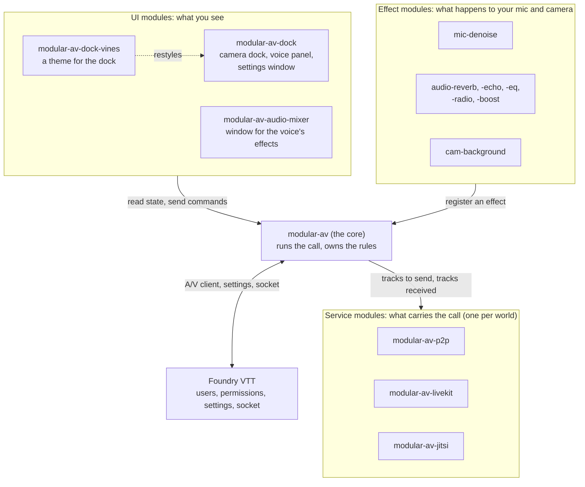
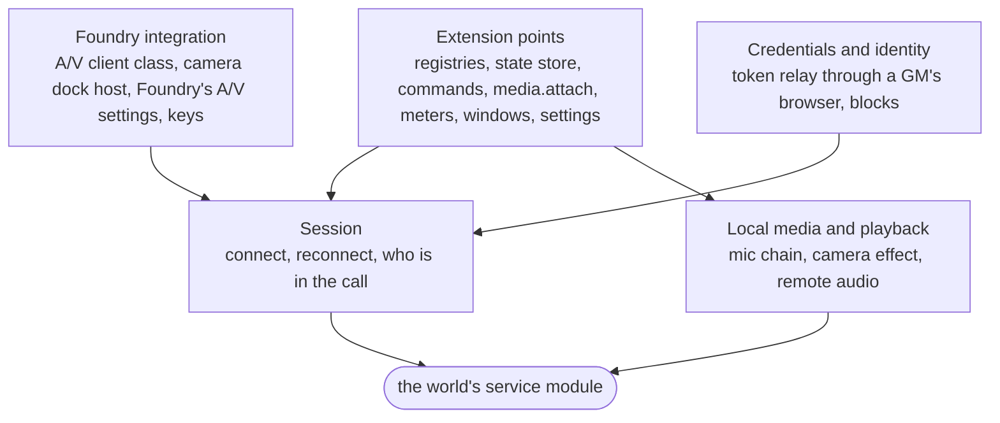
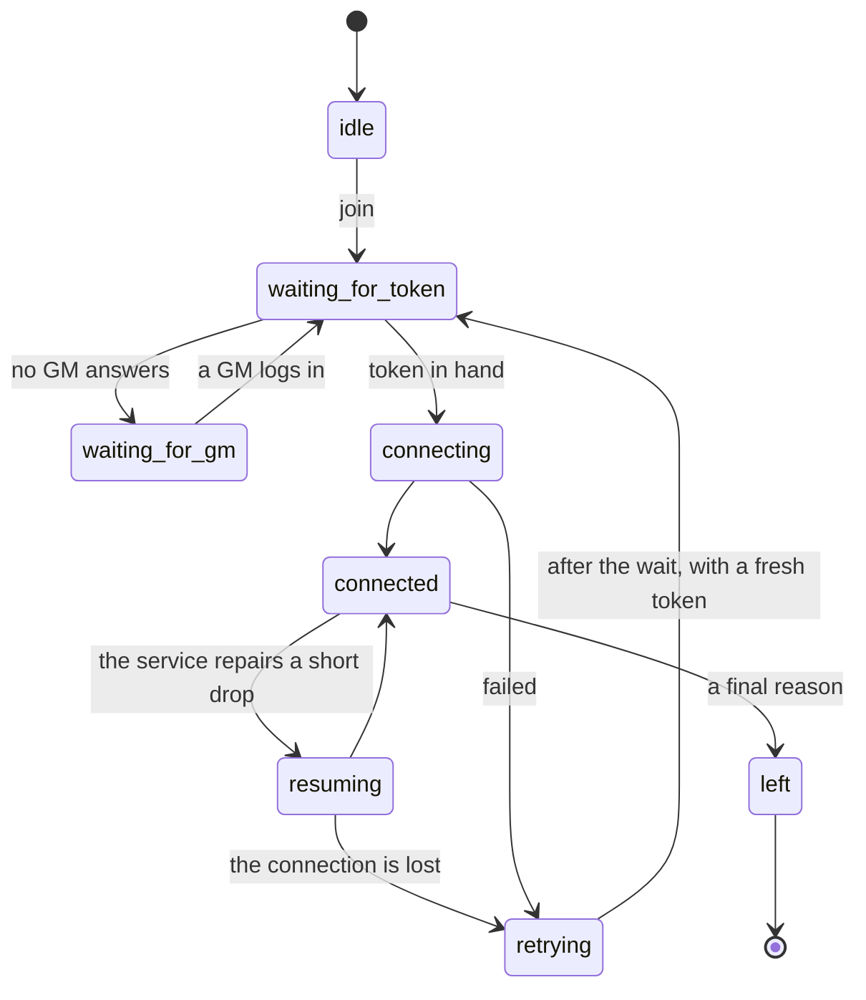
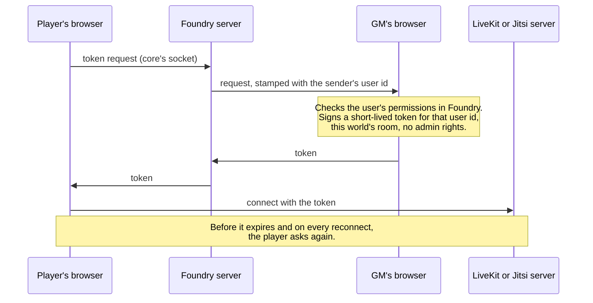
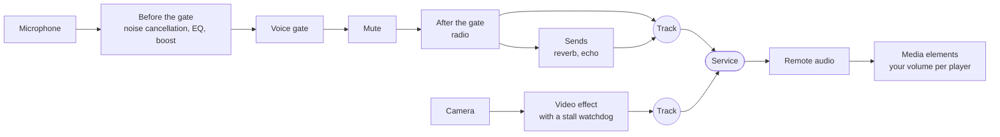

# Architecture

How Modular A/V is put together, for someone about to read or change the
code. It takes about ten minutes. The reasons behind each decision, and
what was tried first, are in the [design log](HANDOFF.md).

## The idea in one picture

A Foundry world has one voice and video call. Modular A/V splits the work
of running it into four kinds of module around a core:



| Kind    | Its job                                               | It never                                    |
| ------- | ----------------------------------------------------- | ------------------------------------------- |
| Core    | Runs the call and keeps its promises (see below)      | Draws a styled UI                           |
| Service | Moves audio and video between browsers                | Decides who is who, or who may speak        |
| Effect  | Turns one track into another, in the player's browser | Chooses where in the chain it runs          |
| UI      | Shows the call's state and turns clicks into commands | Touches a track, a service or a mute itself |
| Theme   | Restyles one UI module through that module's own API  | Hides a state the UI must show              |

Modules never import each other. Each one talks to the core through the
types in `@modular-av/api`, so any service works with any UI and any
effect.

## Three rules that explain most of the code

1. **Promises live in the core.** Mute, a GM's block and "no raw camera
   while a background effect isn't running" are applied by the core, on
   the track it hands to the service. A UI or a service can't get them
   wrong, because none of them implements them.
2. **The core holds the truth, UIs show it.** There is one state store. A
   UI subscribes to it and asks for changes through commands; it never
   assumes that a click worked. That is how the dock can't show "muted"
   or "blurred" when it isn't so.
3. **Services are thin.** Everything that isn't media (who you are,
   tokens, blocks, "deafened", badges) goes over Foundry's own socket and
   user documents, the same way for every service. A service only
   connects, publishes tracks and reports what arrives.

What the core promises to players, whichever modules run:

- Nothing said while muted is sent, in every state of the connection.
- A camera effect that isn't running keeps the camera off.
- A GM's block is enforced even if the blocked player's browser
  misbehaves.
- A service's secret never reaches a player's browser.
- A lost connection is retried without anyone clicking.

These protect against bugs, races and flaky services. They don't protect
against a hostile module: every Foundry module is JavaScript on the same
page, with the same access as the core.

## How a module plugs in

The core fires one hook during Foundry's `setup`. A module registers what
it brings inside that hook and nowhere else:

```ts
Hooks.once("modularAV.register", (api: ModularAV) => {
  api.services.register(myService); // or api.effects, api.surfaces,
  // api.contributions, api.settings
});
```

Registration is synchronous and closes when the hook returns. A module
that registers late gets a clear error instead of being silently missed.
What it registers is a small description; the heavy code (an SDK, a noise
model) loads only when the core starts using it.

The same `api` object stays on `game.modules.get("modular-av").api`:

| Part                                                    | What it is for                                                         |
| ------------------------------------------------------- | ---------------------------------------------------------------------- |
| `state`                                                 | The store: session, participants, your own mic and camera, devices     |
| `commands`                                              | Everything a UI can do: mute, deafen, volumes, devices, effects, leave |
| `media.attach`                                          | Put a participant's video in an element. The core plays the audio      |
| `meters`                                                | Sound levels, measured only while something listens to them            |
| `services`, `effects`, `surfaces`, `contributions`      | The registries modules add to                                          |
| `settings`                                              | A module's own settings, kept with the player or with the device       |
| `windows`                                               | The one Picture-in-Picture window and the popup, shared between UIs    |
| `socket(channel)`                                       | A channel on the core's one Foundry socket                             |
| `preview`, `stats`, `assetUrl`, `createAudioEffectHost` | Device previews, connection details, file URLs, effects under test     |

Two of those words need a line each:

- A **surface** is a place a UI module fills: `cameras` (where the faces
  go), `settings` (the settings window) and `players` (badges in the
  player list). A world has one `cameras` and one `settings` surface.
- A **contribution** is a small item any module declares and every UI
  draws in its own style: a control, an indicator, a participant action,
  a status row or a settings section. It is how noise cancellation gets a
  switch in the dock without either module knowing the other.

The types, and what may change between versions, are in
[`packages/api`](../packages/api/README.md).

## Inside the core



| Layer                    | Code in `packages/core/src`                                                    | What to know                                                                 |
| ------------------------ | ------------------------------------------------------------------------------ | ---------------------------------------------------------------------------- |
| Extension points         | `registry.ts`, `store.ts`, `commands.ts`, `surfaces/`, `windows/`, `settings/` | The public API above                                                         |
| Foundry integration      | `foundry/`                                                                     | The only place that subclasses Foundry's classes                             |
| Credentials and identity | `auth/`                                                                        | A player's identity is their Foundry user id, as Foundry's server reports it |
| Session                  | `session/`, `call/`                                                            | One state machine, the same for every service                                |
| Media                    | `media/`                                                                       | Produces plain `MediaStreamTrack`s, so any service can send them             |
| Plain status             | `status/`                                                                      | Notifications and a badge, so the promises are visible with no UI module     |
| Plan your modules        | `modules/`, `catalog/`                                                         | The GM's window over the module family; apart from the call                  |

### Fitting into Foundry

Foundry has an A/V system of its own, with one plug-in point: the client
class in `CONFIG.WebRTC.clientClass`. The core is that class, and fits
around the rest instead of replacing it:

- Foundry's A/V settings stay the record for what Foundry already knows:
  mute, hide, block, volume up to 100%, devices, voice mode, push to
  talk. The core's store is derived from them and writes back through
  them. Only what Foundry lacks is the core's own (deafen, the gate's
  sensitivity, effects, volume above 100%).
- Foundry calls the client's `connect()` before its socket and `ready`
  exist, so a token can't be fetched there. The core answers `true` at
  once and joins for real after `ready`.
- The core installs a thin camera dock host as Foundry's dock. With no UI
  module it behaves as Foundry's dock; with one, it hides and lets the
  `cameras` surface mount. UI modules never subclass Foundry.

### The session



The states in the API are spelt with hyphens (`"waiting-for-token"`).
P2P needs no token and goes straight to `connecting`.

Retries wait 1, 3, 5, 10 and 20 seconds, then 30 seconds for as long as
it takes, and start at once when the browser comes back online. A final
reason ends them: you left, you joined in another tab, you were removed,
the room closed, the service refused you, or the call is full. Mute and
blocks are applied again on every connect.

### How a player gets in without seeing the secret

LiveKit and Jitsi need a token signed with the server's secret. The
secret is kept in the GM's browser alone (a setting of that device), and
a GM's browser signs each player's token:



The cost is that a GM must be online for players to join; until one is,
the player sees "Waiting for a GM to let you join". A blocked player's
token carries no right to publish, and every other browser also refuses
to play media from them, which is how P2P and Jitsi enforce a block.

### Your microphone, camera and what you hear



- **Microphone.** The core owns the chain: where each effect runs, how
  loud, and the voice gate in the middle. An effect module supplies the
  processing and declares its controls. Mute sits right after the gate
  and is applied to the final track too. The whole of it is in
  [voice-routing.md](voice-routing.md).
- **Camera.** One video effect at a time. If it is starting, stalls or
  fails, the camera stays off and the UI says so; the raw picture is
  never sent in its place. Swapping effects starts the new one before
  the old one stops.
- **What you hear.** The core plays every remote voice, so a call is
  heard with no UI module at all. UIs attach video only. A video that
  isn't on screen stops downloading.
- **Cost.** One capture `AudioContext` at 48 kHz, suspended when nothing
  uses it. Everything heavy loads when first turned on.

## The repository

A pnpm workspace. A package's directory is its Foundry id without the
`modular-av-` prefix, and its npm name is `@modular-av/<directory>`.

| Directory in `packages/`                   | What it is                                           |
| ------------------------------------------ | ---------------------------------------------------- |
| `api`                                      | Types only: the contract every module builds against |
| `core`                                     | `modular-av`, the core                               |
| `kit`                                      | Helpers UI modules bundle (no Foundry id)            |
| `testing`                                  | Fake Foundry, mock service, shared test suites       |
| `p2p`, `livekit`, `jitsi`                  | Services                                             |
| `livekit-krisp`                            | Krisp on LiveKit Cloud, held back from releases      |
| `dock`, `dock-vines`                       | The dock and a theme for it                          |
| `audio-mixer`                              | A window over the voice's effects; planned with them |
| `mic-denoise`, `audio-*`, `cam-background` | Effects                                              |
| `starter-set`                              | No code: requires the usual four, offers a fifth     |

Where a new piece of code goes:

- It has a look (markup, styles, wording): a UI module.
- Two modules would need it and it has no look: the core, or `kit` if it
  is a pure helper with no shared state.
- It is heavy, optional or tied to one service: a module of its own.

Every module is released with the same version until 1.0
([RELEASING.md](RELEASING.md)).

## How it is tested

| Command              | What runs                                                                |
| -------------------- | ------------------------------------------------------------------------ |
| `pnpm test`          | Unit tests against a fake Foundry and a mock service                     |
| `pnpm test:browser`  | Real Chromium with fake devices: the audio chain, the dock, noise models |
| `pnpm test:services` | Each service against its real server in Docker                           |
| `pnpm test:foundry`  | End to end in a local Foundry world                                      |

`@modular-av/testing` holds contract suites that every module of a kind
runs: one for services, one for UI modules (each must show mute, deafen,
speaking, blocked, the connection's state, an open mic and a failed
effect), and others for audio effects, video effects and themes. A new
module that passes its contract fits the rest.

## Where to read next

| You want to                    | Read                                                   |
| ------------------------------ | ------------------------------------------------------ |
| Write a module against the API | [`packages/api`](../packages/api/README.md)            |
| Understand the voice chain     | [voice-routing.md](voice-routing.md)                   |
| Work on the mixer              | [audio-mixer.md](audio-mixer.md)                       |
| Make a theme for the dock      | [dock-theming.md](dock-theming.md)                     |
| Run Foundry locally            | [LOCAL-SETUP.md](LOCAL-SETUP.md)                       |
| Cut a release                  | [RELEASING.md](RELEASING.md)                           |
| Know why it is built this way  | [HANDOFF.md](HANDOFF.md), the design log, and `plans/` |
