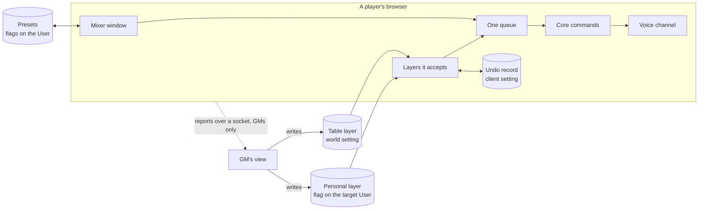

# Audio mixer

`modular-av-audio-mixer` is the window where a player or GM sets up the voice
channel: which effects run, where, in which order and how loud. It saves that
as presets, and it lets a GM see the table's setups and lay a change over them,
such as an echo for a cave. The words come from `docs/voice-routing.md`.

The core holds the commands. The mixer is one client of them, and it ships no
effects. Effects come in their own modules, so a world loads only what it
installs: `modular-av-audio-reverb`, `modular-av-audio-echo`,
`modular-av-audio-eq`, `modular-av-mic-denoise`, and any other. The mixer
neither requires nor recommends them, because a Foundry recommendation prompts
the GM to turn them on.

The dock has no mixer. For audio it shows only noise suppression. Without the
mixer the rest of the pipeline is API only.

## How it fits together

Every client runs the same module. A GM's change travels through Foundry's own
storage, so a player who joins late or reloads still gets it.

## What the core gives it

| API                                 | For                                                                             |
| ----------------------------------- | ------------------------------------------------------------------------------- |
| `commands.setAudioPipeline(change)` | Places, order, mix and Channel level: all checked, saved together, applied once |
| `state.local.chosenEffects`         | What is turned on, in a call or not. `effects` reads `off` without a microphone |
| `preview.voice()`                   | What would be sent, Mute or not, to play back to the player                     |
| `ControlContribution.effect`        | An effect's settings, drawn and saved without knowing the effect                |

`mix` is checked against the places in the same change, so one call can move an
effect to a send and set its Return level. Separate commands couldn't do that:
`setAudioEffectMix` refuses an effect with no mix at its current place, and each
command applies by itself, so a running effect would move through the states in
between.

Setting writes aren't where updates get lost. The core's voice settings are
client settings, and Foundry stores those before `set` returns: 200 rounds of
parallel `setAudioEffectPlace` lost nothing in Foundry 14.369. A world setting
is different. Its value is one JSON string and `#setWorld` awaits the server, so
a parallel read-merge-write lost an update in 10 rounds of 10. That is why the
table layer is replaced whole and never merged. A user flag lost none, because
Foundry diffs an update by key.

## The window

Routing above, levels below, as in a DAW. Routing is a column of cards per
place, left to right as the voice runs: before the gate, the gate, after the
gate, and the sends. Levels holds every fader of the chain in the same order,
with Channel pinned last like a master strip. An effect's own settings open in a
pop-up from the button on its card, with its place, Switch off and Remove.

Only what the player added is drawn. An effect is in the chain while it is on or
its place's order lists it, so switching one off keeps its card, greyed, and
Remove takes it out of the order as well. The core already accepts an order that
lists effects that are off, so presets hold this with no new storage, and a
preset's order is the chain alone. The noise models are one card with a model
picker, as only one runs.

A place's "+" opens an effect browser: a search box, then what this device
added lately, what is made for the place (its `defaultPlace`), everything else,
and what is already in the chain, which moves rather than doubling. It leaves out
what the call can't run, as the API asks of every UI; one saved earlier shows as
Waiting. Effects with a `tail` say they ring on, and are first for a send.

| Key            | On a card                                  |
| -------------- | ------------------------------------------ |
| Arrows         | The next card in the place, or across them |
| Space          | Switch on or off                           |
| Enter          | Its settings                               |
| Alt and arrows | Move it within the place, or to the next   |
| Delete         | Remove it                                  |
| L              | Its fader                                  |

The routing is one tab stop. Dragging a card does what Alt and the arrows do,
and is never the only way. A card's state changes in place, so a fader being
dragged elsewhere is never redrawn under the pointer. The gate shows the only
live level the core has: the microphone after what runs before it, against its
threshold.

Below 640 px the sends go under the effects after the gate and a pop-up spans
the window. The window can't be narrower than 440 px.

## Presets

A preset holds, for each audio effect known when it was saved: on or off, place,
mix if it has one, and its settings. It also holds the order within each place
and Channel level: the chain, as the window draws it. It leaves out what belongs to the device or to the player's
privacy: devices, voice mode, input sensitivity, gate fallback, Cut tails and
video effects.

An effect's settings are the control contributions with `effect: "<id>"`. The
mixer saves `{ controlId: value }` and applies it with `set()`, after checking
it against the control's range or options. The effect keeps owning its setting.
An effect with no such controls is saved without settings. Buttons are skipped.

Presets live in flags on the player's own User, one key per preset, so they
follow the player to any device. Each is one JSON string, because Foundry merges
objects inside flags and an old key would survive a replace. There are at most
32, with names up to 64 characters, shown as text only. Any client can read a
user's flags, so presets aren't private. The active preset is a client setting,
because a device can differ.

A preset's code stays out of the module's entry until it is first needed, so
everything in the macro API returns a promise.

Applying one turns off what must stop, makes one `setAudioPipeline` call, sets
the effect settings, then turns on what must start. An effect swapped within its
exclusive group isn't turned off first, so noise suppression never leaves a gap.
All of it goes through one queue, and a newer preset replaces one still waiting,
so fast switching lands on the last click.

| Effect in the preset is        | What happens                                                |
| ------------------------------ | ----------------------------------------------------------- |
| Not registered                 | Skipped and shown as missing                                |
| `unsupported` in this browser  | Skipped and shown                                           |
| `unavailable` in this call     | Chosen and shown as waiting: the core starts it when it can |
| At a place where it has no mix | Its mix is left out                                         |
| Fails after starting           | Its state shows it, and the voice carries on                |
| Registered, but newer than it  | Stays as it is: a preset speaks only for what it lists      |

A preset is never rewritten by applying it, so one saved with Krisp works again
back on LiveKit Cloud.

## GM control

### Seeing

While a GM's window is open it asks over `api.socket("audio-mixer")`, and each
player reports to GMs only: chosen effects and their status, places, order, mix,
Channel level, effect settings, warnings and layer state. No device names and no
audio. The GM renews the request every 10 s and a player stops 30 s after the
last one, so a closed window costs nothing. Reports are coalesced to one per
300 ms. A player answers only a sender whose Foundry user is a GM, and a GM
reads a report only as the sender's own.

The table tab shows one player at a time, picked from a list, with the same
cards and faders as their own window, read only: no "+", switches or settings.
Their warnings and layer states are listed, and an effect this world lacks is
named by its id.

### Changing

A GM's change is a layer on top of the player's setup, not a replacement. The
commands write the settings the player owns, so a replacement leaves nothing
that remembers the old values, and a crash during the cave leaves the cave in
place.

A layer has the shape of a preset, with only the keys it sets, plus an id, a
label and whether it includes GMs.

- The **table layer** is one world setting for everyone, replaced whole.
- A **personal layer** is a flag on one player's User. It overrides the table
  layer key by key.
- The **undo record** is a client setting holding the values a layer took over.
  It is saved before the layer applies.
- **Reconcile** runs on ready and on any change: take the current setup, put the
  undo record back, apply the layers this client accepts. It is repeatable, so a
  reload mid-cave lands in the same place, and a layer that ended while a player
  was away is undone at their next load.
- A held control is locked and says it is set by the GM. A preset applied
  meanwhile changes the other keys at once, and its value for a held key goes
  into the undo record.

A GM makes a layer from one of their own presets, or a macro writes one by hand
(`game.modules.get("modular-av-audio-mixer").api.layers`). From a preset a layer
takes what it turns on, and Channel level if it isn't full. It leaves out what
the preset turns off, and noise suppression, which stays each player's own. A
layer written by hand can hold either: that is the GM's call.

If a player already runs an effect a layer uses, the layer replaces it for its
duration and the player gets theirs back afterwards. An effect runs once.

Every client validates a layer before using it: registered audio effects only,
known places, levels from 0 to 1, a bounded list, the label shown as text.

| A layer can change                                                  | A layer can never change                                                                      |
| ------------------------------------------------------------------- | --------------------------------------------------------------------------------------------- |
| Effect on or off, place, order, mix, effect settings, Channel level | Devices, voice mode, input sensitivity, gate fallback, mute, deafen, Cut tails, video effects |

### Refusing

A layer applies at once, with a notice and a banner in the window, because a
prompt would break the moment everyone walks into the cave. "Not for me" undoes
one layer on this device, and the next layer applies again. "Keep the GM out of
my voice" is a client setting that ignores all layers, off by default. The GM
sees both.

A GM's real power over a player's voice stays `BROADCAST_AUDIO`, which the core
enforces. A layer is a request carried out by the player's own client. As in the
handoff's trust model, that guards against bugs and accidents, not a hostile
client.

## Warnings

A pure function of the pipeline. Warnings never block.

| When                                              | Why it matters                                 |
| ------------------------------------------------- | ---------------------------------------------- |
| An effect with a `tail` in pre-gate               | It holds the voice gate open                   |
| An effect that isn't a send's, moved to a send    | Its dry signal doubles the voice               |
| Noise suppression outside pre-gate                | The gate hears the noise                       |
| Channel level below 100% with no live send        | It acts as 100% until a send carries the voice |
| Channel level 0 with `automationRate` unavailable | The dry path can't go to 0 without a click     |

## Limits

- A layer's level for an effect at a place with no level of its own overwrites
  the player's saved one: the core reports a level only where an effect has it,
  so there is nothing to record. It matters only if they move that effect to a
  send later.
- A player can send a GM reports nobody asked for, and a GM's open table redraws
  for each. That is a nuisance from a hostile client, outside the trust model.
- With the mixer disabled during a layer, nothing is left to run the undo, so
  the layer's values stay until it is back. An effect module disabled during a
  layer just goes, as the core ignores ids that aren't registered.
- A held key changed from another UI is overwritten when the layer ends.
- Two GMs setting the table layer at once: the last write wins, whole.
- A moved running effect can click, as `docs/voice-routing.md` says. A preset
  does it once.
- A GM can load everyone's CPU with heavy effects. The view shows failures and
  cost is shown when choosing, but nothing prevents it.
- Test my voice needs a microphone in the call. While it records, Mute and the
  push to talk key don't silence it; what goes to the table still follows them.
- There is no level meter after the effects or on a send: the core has only the
  gate's. Levels has no Send switch either, as the core has no such command.
- An effect switched off from another UI or a macro stays in the chain only if
  its place's order lists it, which the mixer's own switch makes sure of.
- "Recent" in the effect browser is kept in this browser only.
