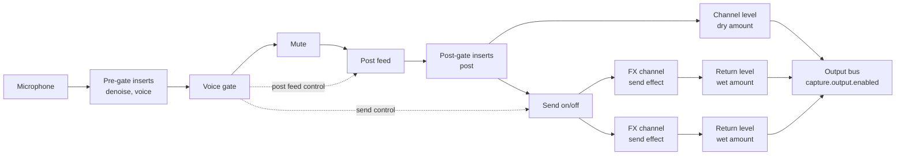
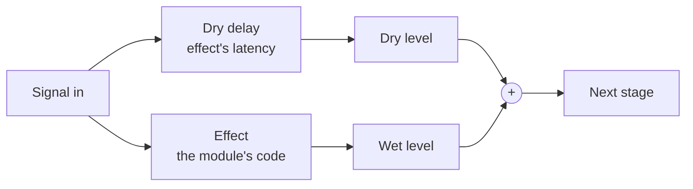

# Voice channel routing

How the microphone travels from the device to the service. The shape and
the words come from Cubase's mixer, and differ where a voice call needs
something else. It grew out of issue #1: a reverb's tail was cut by the
voice gate, and held it open.

## The channel

Solid lines carry sound. Dashed lines carry control, on the audio thread.

## One insert

Every insert can have a dry:wet setting the core owns. The effect outputs
only its processed signal, and the core mixes it with the dry one.

At 100% wet there is no dry branch and no extra node: the insert is a
plain link in the chain. An effect that doesn't declare its `latency` has
no dry:wet control and stays at 100% wet, because mixing it with an
undelayed dry signal would comb-filter the voice (a 10 ms delay puts
notches every 100 Hz).

An FX channel has no dry branch. Its dry signal is the channel itself, and
a dry branch inside it would double the voice.

## Terms

| Term                           | In our chain                                                 | Difference from Cubase                                            |
| ------------------------------ | ------------------------------------------------------------ | ----------------------------------------------------------------- |
| Channel                        | The microphone's path, capture to output                     | In code, not `Channel`: that is the socket API type               |
| Pre-gate and post-gate inserts | `denoise`, `voice` and `post`                                | Our fader comes after all inserts, so the gate marks the boundary |
| Voice gate                     | The core's automatic on/off for speech                       | A fixed part, not a plug-in in a slot                             |
| Mute                           | The core's switch right after the gate                       | Stops what goes in; closing the output bus stops what comes out   |
| Post feed                      | A gain before the post-gate inserts, shut once the gate is   | Exists so native effects can sleep                                |
| Channel level                  | The dry amount, a core setting after the post-gate inserts   | Cubase's channel fader                                            |
| Send                           | A copy taken before Channel level, one per FX channel        | Always pre-fader; network audio is called outbound                |
| Send on/off                    | A gain at exactly 0 or 1 ahead of all sends, set by the gate | Exists so FX channels can sleep                                   |
| FX channel                     | Where a `send` effect runs, wet only                         | Our one channel feeds it; stacking effects in one is not built    |
| Return level                   | The wet amount of an FX channel, a core setting              | Cubase's FX channel fader                                         |
| Output bus                     | `capture.output.enabled`                                     | On or off, with no level                                          |

## `post` or `send`

Both run after the gate. Choose by what the effect has to do.

- `post`: later effects must hear the result, the effect must be able to
  replace the voice, or dry and wet must stay aligned. A radio, an EQ, a
  compressor, a pitch shift, a demon voice.
- `send`: none of those apply, so it adds to the voice. Reverb, delay, echo.
  The voice never passes through it, so a failure or a slow wake can't
  touch speech while Channel level is up, and its tail goes straight to the
  output bus.

## What each event does

| Event                    | Mute             | Send on/off | Output bus        | What is heard                                       |
| ------------------------ | ---------------- | ----------- | ----------------- | --------------------------------------------------- |
| Speech                   | Open             | Open        | Open              | Voice and effects                                   |
| Voice activity pause     | Open             | Closes      | Open              | The tail rings out, then effects sleep              |
| Always on, pause         | Open             | Closes      | Open              | Room sound passes, without sends; FX channels sleep |
| Push to talk release     | Closes           | Closes      | Open for the tail | The tail rings out, then the bus closes             |
| Mute or deafen           | Closes           | Closes      | Open for the tail | The same, unless the player cuts tails              |
| Unmute during the tail   | Opens            | Follows     | Stays open        | The voice carries on                                |
| GM block, or device lost | Closes           | Closes      | Closes at once    | Silence, whatever the player chose                  |
| The gate can't run       | Follows outbound | Open        | Follows outbound  | Sends stay open, so effects keep working            |

The hold on the output bus lasts as long as the longest declared `tail` of
a running effect, at most 3 s, and only while a tail effect runs. With no
tail effect, the bus closes at once. "Cut sound tails" in the voice
settings makes every release close at once. Nothing said after the Mute
closes can reach an effect, so a tail only carries speech that already went
out.

Receivers keep playing a muted sender for the same 3 s, because they stop
on Foundry's `muted` flag, which arrives before the tail ends. The sender's
track still closes on time. A GM block ends playback at once on every
client.

## When effects run

The browser calls a worklet on every block, so an effect can only skip work
if something decides for it.

- **Hosted effects**: the author writes `render()` and declares a `tail`.
  The core's worklet calls `render()` only while there is sound or a tail
  still ringing. This is the default for worklet effects in `post` and
  `send`, and the early return is built in.
- **Native nodes**: the browser skips them once their input is silent and
  their tail has passed. The post feed and Send on/off give them that
  silence, driven by the gate on the audio thread, so a busy page can't
  delay it.
  Firefox has no k-rate gains, and a gain following a signal never lets a
  native node sleep there. So in Firefox the post feed stays open and
  native `post` effects keep running, while Send on/off follows a message
  from the gate: it sleeps, but a busy page can start a reverb late.
- **Worklets an author brings**: these can't be blocked or measured at
  runtime. The effect contract fails one that works on silence, for modules
  that run the contract.

## When an effect goes wrong

Thrown errors aren't enough, so the core also watches the sound.

- Each FX channel's output, before its Return level, is compared with what
  enters the sends. Digital silence while sound goes in counts as a stall.
  A level ratio wouldn't work, because a healthy reverb can be far quieter
  than the voice.
- Post-gate inserts get the same check against the post feed.
- A level far above full scale, or a non-number, counts as a failure at
  once.
- A failed FX channel is silenced as a whole. A failed insert is bypassed.
- If no FX channel is running with a Return level above 0, Channel level
  acts as full, so a player at 0 is never left silent. The core knows that
  at once for an effect that is off or starting, and within the stall time
  for one that went quiet.

## Limits

- Only digital silence, a runaway level and a non-number can be detected.
  An effect that sounds wrong but keeps sounding passes.
- While a tail rings after mute, the player shows as muted. A service's own
  speaking detection may show them speaking for that moment.
- A player on an older core stops a tail at their end.
- A hung `render()` can't be stopped: it holds the audio thread.
- In Firefox, with Channel level at 0, a busy page can clip the start of
  speech, because the voice then depends on a late Send on/off.
- Nothing here is shared between effects yet: a hosted effect has a worklet
  node of its own. Sharing one node would save a little more, and the API
  doesn't show the difference.
