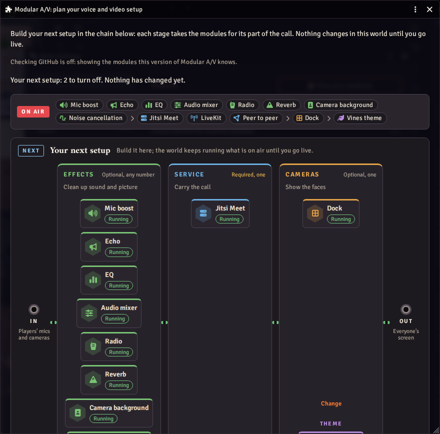

# Modular A/V — voice & video

The core of Modular A/V: it replaces Foundry's A/V client and runs the
call, whichever service carries it and whichever module shows it. On its
own it works with Foundry's camera dock; add a service module and, for
the Discord-like dock, `modular-av-dock`.

- **Services**: `modular-av-livekit` (a LiveKit server or LiveKit Cloud),
  `modular-av-p2p` (no server, small tables) or `modular-av-jitsi` (your
  own Jitsi Meet server). The GM picks one per world.
- **Plan your modules** (GMs, in the module settings and the Voice &
  Video Settings window): the call drawn as a chain of stages (effects,
  the service, the cameras, the dock's theme), with what the world runs
  now beside your next setup.
  - Build the next setup stage by stage, or start from a ready-made one.
  - The window gives the links to install on Foundry's Setup screen: to
    copy, save as a file or whisper to yourself.
  - Applying turns modules on and off for the world, and keeps a service
    on so calls keep working.
  - With no service enabled, a GM is told which exist.

  

- **What it guarantees**, whatever the other modules do: nothing you say
  while muted is sent, in every state of the connection (a reverb or
  echo rings out for up to 3 s of what already went out, unless you turn
  that off); a GM's block is
  enforced by every player's browser; a camera effect that isn't running
  keeps the camera off; it reconnects by itself, with a fresh token each
  time.
- **Your microphone**: its own voice gate for voice activity (automatic,
  or a level you set), push to talk with Foundry's key, a warning when
  you speak while muted. Reverb and delay from effect modules ring out
  after you stop, and you set how much of them to mix in.

## Settings

- **Voice and video service** (world): the service module for this world.
- **Cameras shown by** (world, and per player): Foundry's camera dock or a
  module's, such as the dock.
- **Voice and video settings window** (world): Foundry's or a module's.
- **Check GitHub for module updates** (world, on): see below.

Foundry's own A/V settings (mode, devices, push to talk, relay server)
still apply. Coming from LiveKit AVClient: see
[Moving from LiveKit AVClient](https://github.com/Affid/modular-av/wiki/Moving-from-LiveKit-AVClient).

## Privacy: the one request to GitHub

When a GM opens "Plan your modules", and at most once a day when a GM
loads the world, the GM's browser asks GitHub
(`raw.githubusercontent.com`) for the list of Modular A/V modules, to
tell of updates and new ones, as Foundry's own update checks do. GitHub
sees that browser's address; no cookies or page address go with it.
Players never ask. Turn **Check GitHub for module updates** off and the
window shows the modules this version knows.

## Inside this package

For someone reading the code.
[docs/ARCHITECTURE.md](../../docs/ARCHITECTURE.md) is the guide to this
package: its layers, how a session runs, how a player gets a token, and
what happens to the microphone and camera.

- **What it adds to Foundry**: the A/V client class
  (`CONFIG.WebRTC.clientClass`), a thin host in place of Foundry's
  camera dock, its settings, a socket, and the API other modules
  register with (`game.modules.get("modular-av").api`).
- **Code**: about 15,500 lines in 109 files. `src/media/` (about a
  third) is the microphone chain, the camera and playback;
  `src/modules/` is the Plan your modules window; `src/foundry/` is
  everything that touches Foundry's classes; `src/session/`, `src/call/`
  and `src/auth/` run the call and the token relay. Two audio worklets
  (`public/worklets/`) are the voice gate and the host that runs effect
  modules' audio code. The entry file is held under 124.5 KB; windows,
  statistics and the microphone and camera chains load when first
  needed.
- **Third-party code**: none. It bundles helpers from `@modular-av/kit`
  and implements the types in [`@modular-av/api`](../api/README.md),
  both this repository's own.
- **Network**: the one request to GitHub described above. Everything
  else goes through Foundry's own connection or the service module.
- **Storage**: world settings for the GM's choices, user settings for
  what follows a player, and the browser for what belongs to a device.
- **Tests**: 56 unit test files (`pnpm vitest run packages/core`) and 13
  in a real browser (`pnpm playwright test packages/core`). The unit
  tests run against a fake Foundry and a mock service from
  `@modular-av/testing`; the whole of it is also driven in a real
  Foundry world (`pnpm test:foundry`).

## Licence

MIT. It conflicts with LiveKit AVClient (`avclient-livekit`): enable only
one.
