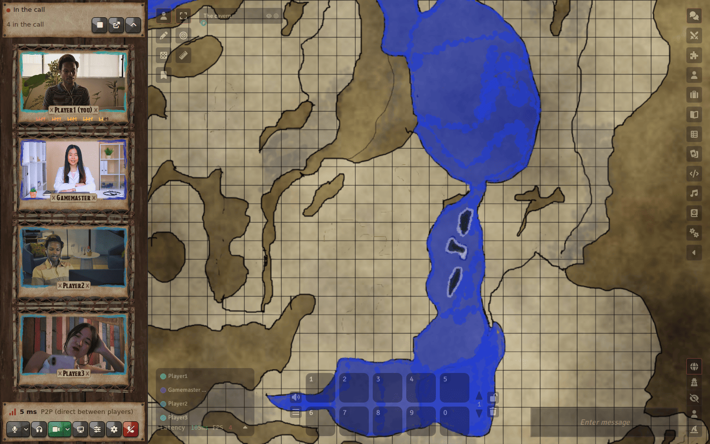
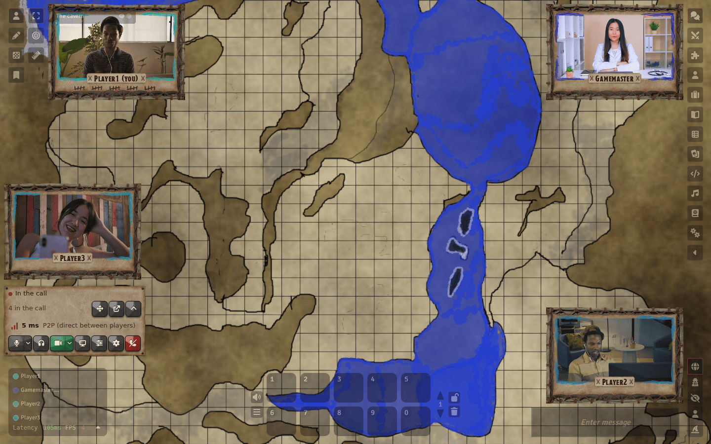

# Modular A/V: Hides theme

<a href="https://github.com/Affid/modular-av/tree/stats">
<picture>
  <source media="(prefers-color-scheme: dark)" srcset="https://raw.githubusercontent.com/Affid/modular-av/stats/badge-modular-av-dock-hides-dark.svg">
  
</picture>
</a>

A theme for [Modular A/V](../../README.md)'s dock, `modular-av-dock`: the
wall of a barbarian's hall, seen from the front. Each camera is a picture
on a hide, and the dock is the timber wall the hides hang on. It is the
look for a barbarian at the table, and each player picks their own theme,
so it doesn't have to be everyone's.

- **Each camera** is on a hide of its own, flesh side out, pulled tight
  by thongs laced round a frame of four lashed poles. The picture is on
  the hide: its edge fades into the leather. The hide's hair shows past
  its edge and hangs down the wall. Neighbours differ: there are two
  hides, each with its own poles and ties.
- **War paint** in the player's colour is daubed round the picture from
  each corner, by hand, with the hide's grain showing in it.
- **A voice is firelight.** It shows through the hide while its player
  speaks. The hide goes dark and dry while they're muted, and when they
  are out of the call the thongs of one corner are cut and hang, the
  hide is slack there and its paint is all but gone.
- **Tally marks** are daubed under your own name, and only under yours:
  they are your level. They light from the left as far as your voice
  reaches, paler while it isn't being sent.
- **Each name** is branded into a tag of pale rawhide, held on the hide by
  a crossed stitch at each end. The states' icons hang on the frame's
  left pole, and other modules' badges on the right one, clear of the
  face and the name.
- **The header and the voice panel** are pieces of the same hide, nailed
  to the wall, and the buttons are the heads of hand-forged iron nails:
  iron at rest, green paint for a camera that is on, red for muted and
  for leaving.
- **Where the cameras leave room**, a horned skull hangs from a peg by a
  thong.
- Menus and the settings window take a palette of smoke, tallow and
  firelight.

A frame takes room round its picture: cameras that fill the dock are
somewhat smaller than in the dock's own look (248 against 288 pixels
wide for three cameras in a dock 300 wide, 122 against 141 for nine).

It works in every layout. The theme suggests a docked one, where the
dock is the wall; scattered, each frame hangs over the scene with a
shadow of its own, and the header and the panel share one piece of hide.
In the theme list it is **Hides (a barbarian's hall)**.





## Install

Install it from Foundry's module browser with its manifest:

```text
https://raw.githubusercontent.com/Affid/modular-av/manifests/modular-av-dock-hides/module.json
```

It requires `modular-av-dock` (and through it `modular-av`). Enable it in
your world, then choose it in **Voice & Video Settings → Appearance**: each
player picks their own theme, or follows the world's theme, which a GM sets
there too.

## What it changes

- Nothing about what the dock does: it restyles the dock through the
  dock's theme API (`docs/dock-theming.md`), and keeps every rule of it:
  mute, deafen, speaking, blocked and connection states always show, faces
  stay clear of the frame, text and icons meet WCAG AA, and nothing moves
  when your system asks for reduced motion.
- Its stylesheet loads only while the theme is chosen.

## Inside this package

For someone reading the code. How the modules fit together is in
[docs/ARCHITECTURE.md](../../docs/ARCHITECTURE.md).

- **What it adds**: one theme, registered with the dock's
  `themes.register` (`src/index.ts`, 34 lines).
- **Code**: that file and a stylesheet of about 390 lines
  (`public/hides.css`). No logic of its own: what follows the room under
  the cameras does so in the stylesheet, from a number the dock sets. The
  entry file is held under 2 KB and the stylesheet under 14 KB.
- **Pictures**: 19 files in `public/art`, about 585 KB together; a page
  loads only those for the layout and states it shows.
  - _Rendered_ (18 WebP files): the wall; two hides, and for each the
    same hide with its thongs cut, where light shows through it, and its
    paint; the name's tag, the nailed piece and the leather under it,
    three nail heads and a longer one in two parts, and the skull. They are rendered
    with Blender from scenes that are scripts in this repository
    (`tools/art/hides/render`), all under one light. Making them again
    needs Blender 4.5 or later: `pnpm art:hides:render` renders them,
    converts them and lists each with its hash in
    `tools/art/hides/rendered.json`. No test can render, so a test fails
    when the files here are not the ones listed.
  - _Drawn_ (1 SVG file): the tally marks, as the mask the level meter is
    cut to. A script draws it from a fixed seed (`pnpm art:hides`), the
    same every time, and a test fails when the file here isn't what it
    draws. The war paint's daubs are drawn too (`tools/art/hides/paint.ts`),
    by the render script, which has the hide's scene paint them on the
    hide: they ship as rendered pictures.
- **Third-party code**: none. The rendered pictures show five
  photographed textures from Poly Haven and one scanned skull from the
  Smithsonian's open-access collection, all under CC0: see
  [THIRD-PARTY-NOTICES.md](THIRD-PARTY-NOTICES.md). **Network**: none.
  **Storage**: none.
- **Tests**: two browser test files (`pnpm playwright test
packages/dock-hides`). One runs the shared theme contract from
  `@modular-av/testing` in four layouts (contrast, faces left clear,
  every state still shown, nothing moving under reduced motion) and
  checks each hide, its paint and its states; the other checks the wall,
  the nailed pieces, the buttons and the skull in every placement. The
  art tool has unit tests of its own, and one that ties the stylesheet's
  numbers to the measures the pictures were made to.

## Licence

MIT, artwork included: the pictures in `public/art` were made for this
module by the scripts in `tools/art/hides`, which are part of this
repository. No image model went into them. The five photographed
textures the renders use and the scanned skull are in the public domain
(CC0); the skull's horns were made here.
