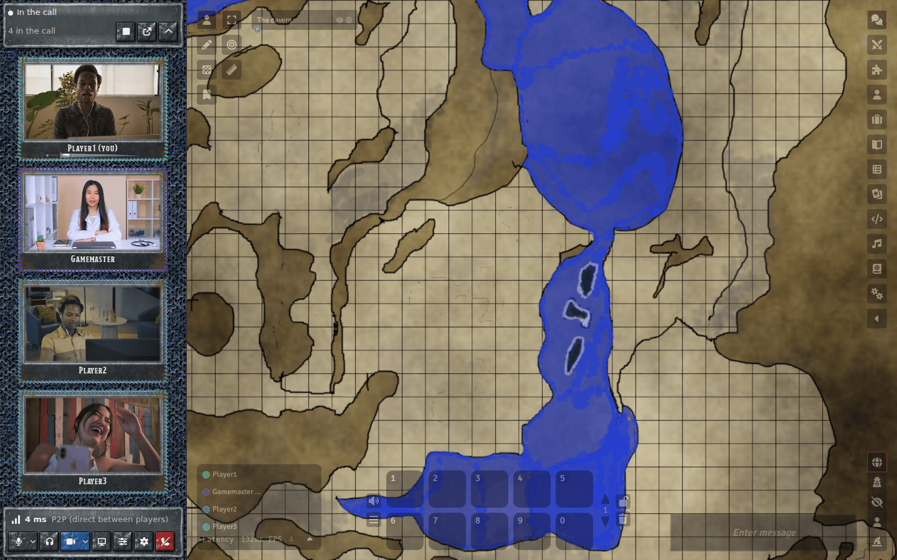
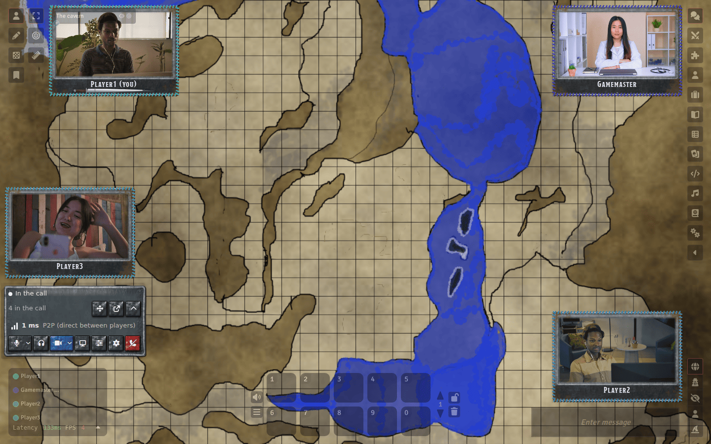

# Modular A/V: Plates theme

<a href="https://github.com/Affid/modular-av/tree/stats">
<picture>
  <source media="(prefers-color-scheme: dark)" srcset="https://raw.githubusercontent.com/Affid/modular-av/stats/badge-modular-av-dock-plates-dark.svg">
  
</picture>
</a>

A theme for [Modular A/V](../../README.md)'s dock, `modular-av-dock`: a
fighter's harness, seen from the front. Each camera sits in a plate of
steel, and the dock is the mail the plates lie on. It is the look for a
fighter at the table, and each player picks their own theme, so it
doesn't have to be everyone's.

- **Each camera** is in a plate of its own: dark steel that has been
  oiled and carried for years, hammered and dented, rusty in its corners,
  bright only where it is rubbed. Its edge is rolled, a rib runs round
  the picture, and rivets hold it down. Neighbours differ: there are two
  plates, each with its own dents and rust.
- **A cord** in the player's colour is laced round the plate, through
  holes inside its rolled edge.
- **A voice is polish.** The rib, the rolled edge and the steel round the
  picture go bright while a player speaks. The plate goes dull and dark
  while they're muted, and when they are out of the call it rusts from
  its corners, a rivet is gone, and the cord is lost down one side.
- **A knife** lies in two staples under your own name, and only under
  yours: its blade is your level. It shines from the guard as far as
  your voice reaches, duller while it isn't being sent.
- **Each name** is cut into a band of the plate that is left black from
  the forge and never polished, so it reads the same whatever the plate
  is doing. The states' icons stand at the plate's upper left corner and
  other modules' badges at its upper right, clear of the face and the
  name; on a small camera they shrink with it.
- **The header and the voice panel** are larger plates of the same
  steel, and the buttons are small hammered ones: dark steel at rest,
  blued steel for a camera that is on, red paint for muted and for
  leaving.
- **The mail** is worn over deep blue cloth, which shows between its
  rings.
- **Where the cameras leave room**, one of the fighter's things shows,
  the tallest that fits whole: a flanged mace lying in two staples, a
  pair of gauntlets hung by a thong, or a buckler hung by its strap.
- Menus and the settings window take a palette of dark steel.

A plate takes room round its picture: cameras that fill the dock are
somewhat smaller than in the dock's own look (257 against 288 pixels
wide for three cameras in a dock 300 wide, 126 against 141 for nine).

It works in every layout. The theme suggests a docked one, where the
dock is the mail; scattered, each plate lies over the scene with a
shadow of its own, and the header and the panel share one larger plate.
In the theme list it is **Plates (a fighter's harness)**.





## Install

Install it from Foundry's module browser with its manifest:

```text
https://raw.githubusercontent.com/Affid/modular-av/manifests/modular-av-dock-plates/module.json
```

It requires `modular-av-dock` (and through it `modular-av`). Enable it in
your world, then choose it in **Voice & Video Settings → Appearance**: each
player picks their own theme, or follows the world's theme, which a GM sets
there too.

## What it changes

- Nothing about what the dock does: it restyles the dock through the
  dock's theme API (`docs/dock-theming.md`), and keeps every rule of it:
  mute, deafen, speaking, blocked and connection states always show, faces
  stay clear of the frame, text and icons meet WCAG AA, and nothing moves
  when your system asks for reduced motion.
- Its stylesheet loads only while the theme is chosen.

## Inside this package

For someone reading the code. How the modules fit together is in
[docs/ARCHITECTURE.md](../../docs/ARCHITECTURE.md).

- **What it adds**: one theme, registered with the dock's
  `themes.register` (`src/index.ts`, 34 lines).
- **Code**: that file and a stylesheet of about 420 lines
  (`public/plates.css`). No logic of its own: what follows the room under
  the cameras does so in the stylesheet, from a number the dock sets. The
  entry file is held under 2 KB and the stylesheet under 14 KB.
- **Pictures**: 22 WebP files in `public/art`, about 670 KB together.
  Most load with the dock, so that a voice and a change of room show at
  once; the rusted plates and their lost cords load when a player is first
  out of the call. All of them are rendered: the mail;
  two plates, and for each the same plate polished and rusted, and its
  cord whole and lost; the knife and its blade alone, which the level
  meter is cut to; the larger plate's edge and the steel under it; two
  small plates for buttons and a longer one in two parts; the mace, the
  gauntlets and the buckler. They are rendered with Blender from scenes
  that are scripts in this repository (`tools/art/plates/render`), all
  under one light. Making them again needs Blender 4.5 or later:
  `pnpm art:plates:render` renders them, converts them and lists each
  with its hash in `tools/art/plates/rendered.json`. No test can render,
  so a test fails when the files here are not the ones listed.
- **Third-party code**: none. The rendered pictures show three
  photographed textures from Poly Haven, all under CC0: see
  [THIRD-PARTY-NOTICES.md](THIRD-PARTY-NOTICES.md). **Network**: none.
  **Storage**: none.
- **Tests**: two browser test files (`pnpm playwright test
packages/dock-plates`). One runs the shared theme contract from
  `@modular-av/testing` in four layouts (contrast, faces left clear,
  every state still shown, nothing moving under reduced motion) and
  checks each plate, its cord and its states; the other checks the mail,
  the larger plates, the buttons and the things in the free room in every
  placement. The art tool has unit tests of its own, and one that ties
  the stylesheet's numbers to the measures the pictures were made to.

## Licence

MIT, artwork included: the pictures in `public/art` were made for this
module by the scripts in `tools/art/plates`, which are part of this
repository. No image model went into them. The three photographed
textures the renders use are in the public domain (CC0).
