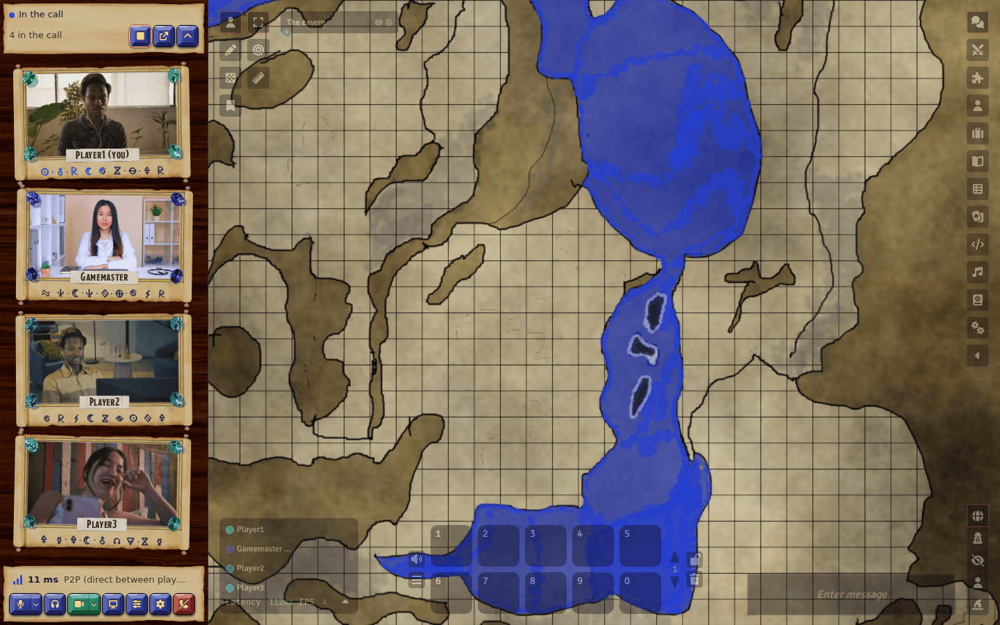
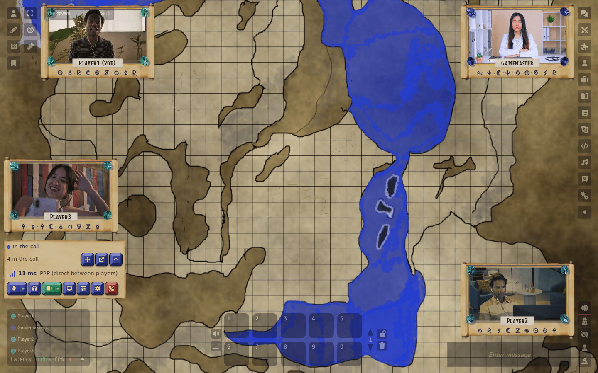

# Modular A/V: Scrolls theme

<a href="https://github.com/Affid/modular-av/tree/stats">
<picture>
  <source media="(prefers-color-scheme: dark)" srcset="https://raw.githubusercontent.com/Affid/modular-av/stats/badge-modular-av-dock-scrolls-dark.svg">
  
</picture>
</a>

A theme for [Modular A/V](../../README.md)'s dock, `modular-av-dock`: a
wizard's desk seen from above. Each camera is a picture in a scroll of
worn vellum, and the dock is the desk they lie on. It is the look for a
wizard at the table, and each player picks their own theme, so it
doesn't have to be everyone's.

- **Each camera** is in a scroll of its own, with a roll at each side on
  a turned wooden rod. The picture is in the paper: its edge fades into
  the vellum under ruled ink lines and a thin line of gold leaf. Docked,
  the scrolls lie a little askew and a little apart, as if laid down by
  hand.
- **Four cut stones** hold each scroll open, in its player's colour. They
  show who the player is and how they stand: bright and glowing while
  they speak, dull while they're muted, cracked and colourless when they
  are out of the call.
- **A row of pen-drawn signs** under the picture shows a voice. It lights
  blue while that player speaks; on your own scroll it lights from the
  left as far as your level, paler while your voice isn't being sent.
- **Each name** is cut into a plate of old bone that lies on the scroll's
  lower edge. The states' icons hang on the scroll's left rod like tags,
  clear of the face and the name.
- **The header and the voice panel** are papers of the same vellum,
  written in ink, and the buttons are cut stones: sapphire at rest,
  emerald for a camera that is on, ruby for muted and for leaving.
- **Where the cameras leave room**, a wizard's things lie on the desk: a
  granite mortar with crushed blue crystal, a corked vial, violet
  crystals, gold coins, a brass key, loose stones; with a lot of room, a
  wand above them.
- Menus and the settings window take a palette of indigo, cream and
  gold.

A scroll takes room round its picture: cameras that fill the dock are
somewhat smaller than in the dock's own look (252 against 288 pixels
wide for three cameras in a dock 300 wide, 124 against 141 for nine).

It works in every layout. The theme suggests a docked one, where the
dock is the desk; scattered, each scroll lies on the scene with a shadow
of its own, and the header and the panel share one paper. In the theme
list it is **Scrolls (a wizard's desk)**.





## Install

Install it from Foundry's module browser with its manifest:

```text
https://raw.githubusercontent.com/Affid/modular-av/manifests/modular-av-dock-scrolls/module.json
```

It requires `modular-av-dock` (and through it `modular-av`). Enable it in
your world, then choose it in **Voice & Video Settings → Appearance**: each
player picks their own theme, or follows the world's theme, which a GM sets
there too.

## What it changes

- Nothing about what the dock does: it restyles the dock through the
  dock's theme API (`docs/dock-theming.md`), and keeps every rule of it:
  mute, deafen, speaking, blocked and connection states always show, faces
  stay clear of the frame, text and icons meet WCAG AA, and nothing moves
  when your system asks for reduced motion.
- Its stylesheet loads only while the theme is chosen.
- Each scroll in a docked dock is turned by about a degree, its picture
  with it. A browser draws a turned picture a touch softer.

## Inside this package

For someone reading the code. How the modules fit together is in
[docs/ARCHITECTURE.md](../../docs/ARCHITECTURE.md).

- **What it adds**: one theme, registered with the dock's
  `themes.register` (`src/index.ts`, 34 lines).
- **Code**: that file and a stylesheet of about 500 lines
  (`public/scrolls.css`). No logic of its own: what follows the room
  under the cameras does so in the stylesheet, from a number the dock
  sets. The entry file is held under 2 KB and the stylesheet under 19 KB.
- **Pictures**: 32 files in `public/art`, about 505 KB together; a page
  loads only those for the layout and states it shows.
  - _Rendered_ (15 WebP files): the desk, two scrolls, and for each its
    stones, their shadow, their flashes and their glow; the name's plate,
    the paper, the desk's things and the wand. They are rendered with
    Blender from scenes that are scripts in this repository
    (`tools/art/scrolls/render`), all under one light. Making them again
    needs Blender 4.5 or later: `pnpm art:scrolls:render` renders them,
    converts them and lists each with its hash in
    `tools/art/scrolls/rendered.json`. No test can render, so a test
    fails when the files here are not the ones listed.
  - _Drawn_ (17 SVG files): what is flat by nature. Four hands of
    writing (the ruled lines and gold leaf with the signs, the signs
    alone as a mask, their glow), the cracks for each scroll's stones,
    and a button's facets whole and in two parts. A script draws them
    from fixed seeds (`pnpm art:scrolls`), the same every time, and a
    test fails when the files here aren't what it draws.
- **Third-party code**: none. The rendered pictures show three
  photographed textures under CC0 (two woods from Poly Haven, a paper
  from ambientCG): see [THIRD-PARTY-NOTICES.md](THIRD-PARTY-NOTICES.md).
  **Network**: none. **Storage**: none.
- **Tests**: two browser test files (`pnpm playwright test
packages/dock-scrolls`). One runs the shared theme contract from
  `@modular-av/testing` in four layouts (contrast, faces left clear,
  every state still shown, nothing moving under reduced motion) and
  checks each scroll, its stones and its states; the other checks the
  desk, the papers and the buttons in every placement. The art tool has
  unit tests of its own, and one that ties the stylesheet's numbers to
  the measures the pictures were made to.

## Licence

MIT, artwork included: the pictures in `public/art` were made for this
module by the scripts in `tools/art/scrolls`, which are part of this
repository. No image model and no outside artwork went into them; the
three photographed textures the renders use are in the public domain
(CC0).
