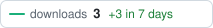

# Modular A/V: Strongbox theme

<a href="https://github.com/Affid/modular-av/tree/stats">
<picture>
  <source media="(prefers-color-scheme: dark)" srcset="https://raw.githubusercontent.com/Affid/modular-av/stats/badge-modular-av-dock-strongbox-dark.svg">
  
</picture>
</a>

A theme for [Modular A/V](../../README.md)'s dock, `modular-av-dock`: a
rogue's locked box, seen from the front. The dock is the box's front of
dark oiled boards in a forged iron band, and each camera is a window cut
in it. It is the look for a rogue at the table, and each player picks
their own theme, so it doesn't have to be everyone's.

- **The box**: wide boards of smoked, oiled wood nailed to the box's end
  battens, bound in an iron band with folded iron brackets on its
  corners; a padlock hangs on its hasp at the header's right.
- **Each camera** is a window bound in a forged iron strap, riveted, with
  a lock over its top edge. Three locks take turns, so that neighbours
  never match, two to a row or one, and with one camera large: a forged
  shield, a round domed plate with a swing cover, and a wide lock case
  with a slide.
- **A voice lights the lamp** inside the box: amber through the keyhole,
  warm on the strap near it. On a poor link the lamp gutters, coming and
  going (still, and dimmer, when your system asks for reduced motion).
- **Muted**, an iron shutter slides down to the picture's margin and the
  hasp folds over the lock with a padlock on it. **Deafened**, a rag of
  grey wool is stuffed into the keyhole, a torn corner hanging out.
  **Out of the call**, the lock is forced: its plate prised off and
  hanging askew, bright gouges in the iron, the window dark.
- **A camera that is off** shows the box's inside: padded green velvet,
  buttoned, lit from below by the lamp.
- **Your level** is the lamp's flame seen through a slot in the strap
  under your own camera, as far as your voice goes.
- **Each name** is stencilled in pale paint on the boards under its
  window, worn along the grain. The states' icons stand on iron plates
  at the picture's upper left, other modules' badges at its upper right.
- **The buttons** are small forged plates; a pressed one is sunk in its
  rim, the lamp on its lower lip.
- **Where the cameras leave room**, the rogue's things show on the bare
  boards as there is room for them: a throwing knife stuck in the wood,
  then a ring of lockpicks, a ring of keys on a nail, and a coil of rope
  with a grappling hook on an iron spike.

A window takes room round its picture: cameras that fill the dock are
somewhat smaller than in the dock's own look (249 against 288 pixels
wide for three cameras in a dock 300 wide, 123 against 141 for nine).

It works in every layout. The theme suggests a docked one, where the
dock is the box; scattered, each window lies on its own panel of the
boards. In the theme list it is **Strongbox (a rogue's locked box)**.

## Install

Install it from Foundry's module browser with its manifest:

```text
https://raw.githubusercontent.com/Affid/modular-av/manifests/modular-av-dock-strongbox/module.json
```

It requires `modular-av-dock` (and through it `modular-av`). Enable it in
your world, then choose it in **Voice & Video Settings → Appearance**: each
player picks their own theme, or follows the world's theme, which a GM sets
there too.

## What it changes

- Nothing about what the dock does: it restyles the dock through the
  dock's theme API (`docs/dock-theming.md`), and keeps every rule of it:
  mute, deafen, speaking, blocked and connection states always show, faces
  stay clear of the iron, text and icons meet WCAG AA, and nothing moves
  when your system asks for reduced motion.
- Its stylesheet loads only while the theme is chosen.

## Inside this package

For someone reading the code. How the modules fit together is in
[docs/ARCHITECTURE.md](../../docs/ARCHITECTURE.md).

- **What it adds**: one theme, registered with the dock's
  `themes.register` (`src/index.ts`).
- **Code**: that file and a stylesheet (`public/strongbox.css`). No logic
  of its own: what follows the room under the cameras does so in the
  stylesheet, from a number the dock sets, and the locks take turns by
  the tiles' order. The entry file is held under 2 KB and the stylesheet
  under 19 KB.
- **Pictures**: 33 WebP files in `public/art`, about 650 KB together.
  All of them are rendered: the boards and the strap; each of the three
  locks' windows at rest, speaking, muted, deafened and out of the call;
  the level's slot, dark and lit, and its mask; the buttons, the padlock
  and the corner brackets; the stencil's wear; the velvet lining; the
  knife, the picks, the keys and the rope. They are rendered with
  Blender from scenes that are scripts in this repository
  (`tools/art/strongbox/render`), all under one light. Making them again
  needs Blender 4.5 or later: `pnpm art:strongbox:render` fetches what
  the scenes read, renders, converts and lists each picture with its
  hash in `tools/art/strongbox/rendered.json`. No test can render, so a
  test fails when the files here are not the ones listed.
- **Third-party code**: none. The rendered pictures show four
  photographed textures from Poly Haven, all under CC0: see
  [THIRD-PARTY-NOTICES.md](THIRD-PARTY-NOTICES.md). **Network**: none.
  **Storage**: none.
- **Tests**: two browser test files (`pnpm playwright test
packages/dock-strongbox`). One runs the shared theme contract from
  `@modular-av/testing` in four layouts and checks the windows, their
  locks and states, the name and the level; the other checks the box,
  its brackets and padlock in every placement, the buttons (the menu
  arrow's chevron is measured on the pixels), the boards' evenness and
  seams, and what the free room shows. The art tool has unit tests of its
  own, and one that ties the stylesheet's numbers to the measures the
  pictures were made to.

## Licence

MIT, artwork included: the pictures in `public/art` were made for this
module by the scripts in `tools/art/strongbox`, which are part of this
repository. No image model went into them. The photographed textures the
renders use are in the public domain (CC0).
