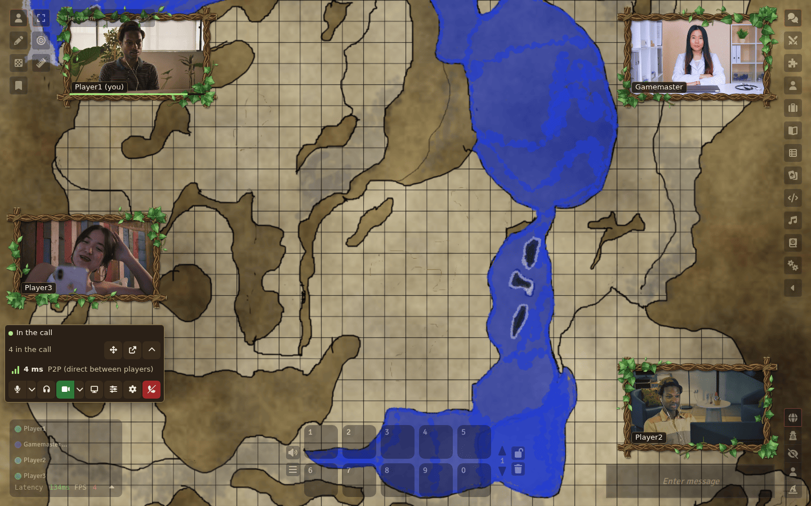

# Modular A/V: Vines theme

<a href="https://github.com/Affid/modular-av/tree/stats">
<picture>
  <source media="(prefers-color-scheme: dark)" srcset="https://raw.githubusercontent.com/Affid/modular-av/stats/badge-modular-av-dock-vines-dark.svg">
  
</picture>
</a>

A theme for [Modular A/V](../../README.md)'s dock, `modular-av-dock`: a
druid's grove. Cameras framed in branches that look grown rather than
built, with ivy, on a dock that is one plant. It is the look for a druid
or a ranger at the table, and each player picks their own theme, so it
doesn't have to be everyone's.

- **Each camera** sits in a frame of its own: branches twisted into an
  uneven loop, with ivy growing from one corner. There are four frames,
  no two the same shape, and the picture is cut to its frame. A scattered
  camera takes the frame for the corner of the screen it sits in.
- **Each name** is cut into a strip of bark that hangs under its camera
  on two loops of withy, so the picture is clear of it. Your own level is
  a shoot along your frame's bottom branch that greens with your voice.
- **Docked, floating or in a window**, a thick trunk of the same branches
  runs down the dock's free edge. Boughs off it hold the header and the
  voice panel, and the cameras hang under them on lianas, one under
  another. Where the cameras leave room, the lianas' loose ends hang on
  under the last of them and a leafy branch grows in off the trunk: a
  sprig, a branch or a tall one, by how much room there is. Docked at the
  top or bottom, the trunk runs across the top and the cameras hang under
  it.
- While someone speaks, a soft light in a tint of their colour shows on
  the picture's rim, between the branches. While they're muted, their
  leaves turn to autumn, and a player who is out of the call has bare
  stems.
- The dock, its menus and the settings window take a palette of bark and
  leaf.

The plant takes room: beside the trunk and with a name under each
camera, cameras are somewhat smaller than in the dock's own look when
they fill the dock. A collapsed dock is too narrow for it and stays
plain.

The dock offers its scattered layout when the theme is chosen, where
the frames have the most room; docked, the dock itself is the plant. It
works in every layout. In the theme list it is **Vines (a druid's
grove)**.



## Install

Install it from Foundry's module browser with its manifest:

```text
https://raw.githubusercontent.com/Affid/modular-av/manifests/modular-av-dock-vines/module.json
```

It requires `modular-av-dock` (and through it `modular-av`). Enable it in
your world, then choose it in **Voice & Video Settings → Appearance**: each
player picks their own theme, or follows the world's theme, which a GM sets
there too.

## What it changes

- Nothing about what the dock does: it restyles the dock through the
  dock's theme API (`docs/dock-theming.md`), and keeps every rule of it:
  mute, deafen, speaking, blocked and connection states always show, faces
  stay clear of the leaves, text and icons meet WCAG AA, and nothing moves
  when your system asks for reduced motion.
- Its stylesheet loads only while the theme is chosen.

## Inside this package

For someone reading the code. How the modules fit together is in
[docs/ARCHITECTURE.md](../../docs/ARCHITECTURE.md).

- **What it adds**: one theme, registered with the dock's
  `themes.register` (`src/index.ts`, 36 lines).
- **Code**: that file and a stylesheet of about 500 lines
  (`public/vines.css`). No logic of its own: what follows the room under
  the cameras does so in the stylesheet, from two numbers the dock sets.
  The entry file is held under 2 KB and the stylesheet under 19 KB.
- **Pictures**: 52 SVG files in `public/frames`, about 770 KB together; a
  page loads only those for the layout and states it shows. For each of
  the four frames: its branches, the picture's shape (the video's mask
  and the ground behind it), the speaking light, the ivy in summer, its
  autumn leaves and its bare stems, the lianas it hangs on (tied only,
  and with loose ends, long and short) and the withy that ties them. For
  the dock: the trunk, down and across, four boughs, the branch in three
  sizes, the name's plate and loop, and the shoot the level shows
  through. They are drawn by a script,
  `tools/art/vines` (run `pnpm art:vines` after changing it): the same
  pictures every time, from fixed seeds. A test fails when the files
  here aren't what the script draws.
- **Third-party code**: none. **Network**: none. **Storage**: none.
- **Tests**: one browser test file (`pnpm playwright test
packages/dock-vines`) that runs the shared theme contract from
  `@modular-av/testing` in every layout and state (contrast, faces left
  clear, every state still shown, nothing moving under reduced motion)
  and checks each state's pictures. The script has unit tests of its
  own: no branch or leaf in the middle of the picture, nothing outside
  the frame layer.

## Licence

MIT, artwork included: the pictures in `public/frames` were drawn for this
module by the script in `tools/art/vines`, which is part of this
repository. No image model and no outside artwork went into them.
