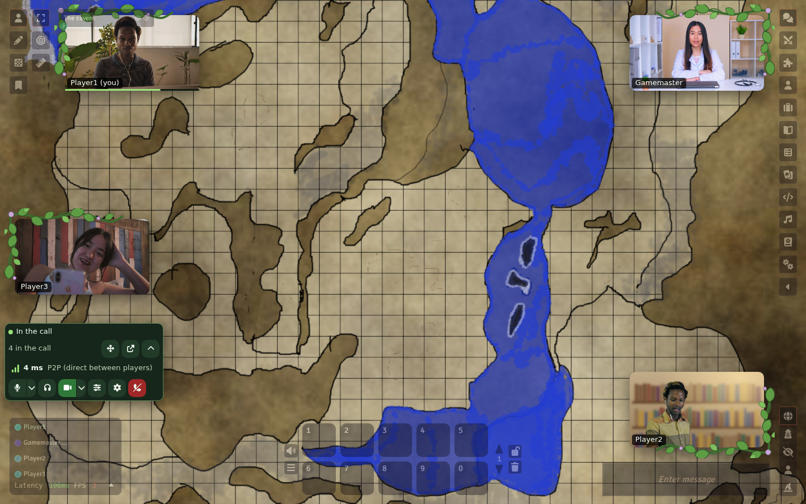

# Modular A/V: Vines theme

A theme for [Modular A/V](../../README.md)'s dock, `modular-av-dock`: vine
leaves around each camera, growing from the corner it sits in, a soft green
glow while someone speaks, grey leaves while they're muted, and a green
palette for the dock, its menus and the settings window. It suits the
dock's scattered layout best, and the dock offers it when the theme is
chosen; it works in every layout.



## Install

Install it from Foundry's module browser with its manifest:

```text
https://raw.githubusercontent.com/Affid/modular-av/manifests/modular-av-dock-vines/module.json
```

It requires `modular-av-dock` (and through it `modular-av`). Enable it in
your world, then choose it in **Voice & Video Settings → Appearance**: each
player picks their own theme, or follows the world's theme, which a GM sets
there too.

## What it changes

- Nothing about what the dock does: it restyles the dock through the
  dock's theme API (`docs/dock-theming.md`), and keeps every rule of it:
  mute, deafen, speaking, blocked and connection states always show, faces
  stay clear of the leaves, text and icons meet WCAG AA, and nothing moves
  when your system asks for reduced motion.
- Its stylesheet loads only while the theme is chosen.

## Inside this package

For someone reading the code. How the modules fit together is in
[docs/ARCHITECTURE.md](../../docs/ARCHITECTURE.md).

- **What it adds**: one theme, registered with the dock's
  `themes.register` (`src/index.ts`, 29 lines).
- **Code**: that file, a stylesheet of about 90 lines
  (`public/vines.css`) and one SVG. No logic of its own. The entry file
  is held under 2 KB and the stylesheet under 8 KB.
- **Third-party code**: none. **Network**: none. **Storage**: none.
- **Tests**: one browser test file (`pnpm playwright test
packages/dock-vines`) that runs the shared theme contract from
  `@modular-av/testing` in every layout and state: contrast, faces left
  clear, every state still shown, nothing moving under reduced motion.

## Licence

MIT, artwork included: the vine leaves (`public/frames/vine-corner.svg`)
were drawn for this module.
