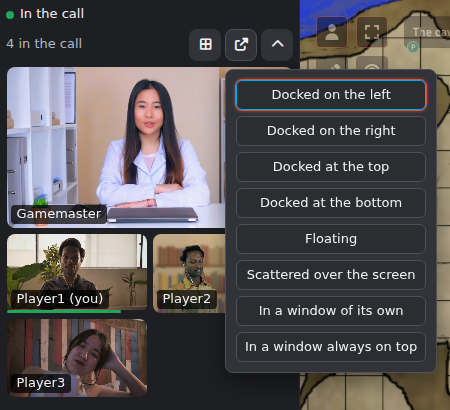
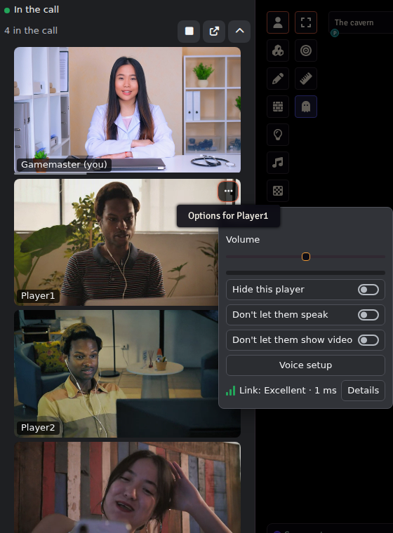

# Modular A/V: Dock

The face of Modular A/V: a Discord-like camera dock with a voice panel, a
voice and video settings window and badges in the player list. Requires
`modular-av`; choose it in Modular A/V's settings ("Cameras shown by",
"Voice and video settings window").

- **Dock**: beside Foundry's sidebar or floating, a grid or one player in
  focus, or in a window of its own: a normal window you can drag to another
  monitor and put full screen (every browser, unless a popup blocker
  refuses it), or a window always on top of the others
  (Picture-in-Picture, in Chrome and Edge, which can't go full screen). A
  window closes with Foundry's page.
- **Scattered over the screen**: each camera on its own, against a corner
  or edge or wherever you drag it, resized as you like, by mouse or
  keyboard; Foundry's sidebar, controls, hotbar and chat stay clear. A GM
  can save the arrangement as a scene's layout for everyone; a player who
  moves a camera there keeps their own, and can go back to the scene's.
- **Voice panel**: mute, deafen, camera, the input level and sensitivity,
  and the effects other modules add (noise cancellation, camera
  background).
- **Players**: who is speaking, muted, deafened or blocked, a volume per
  player and a menu for GMs.
- **Themes**: other modules add them (such as `modular-av-dock-vines`);
  choose one in Voice & Video Settings, Appearance, or follow the world's.
  Making one: [docs/dock-theming.md](../../docs/dock-theming.md).
- Keyboard and screen reader friendly.

Its layout is kept per player, across devices. Coming from LiveKit
AVClient, your layout comes along; see
[Moving from LiveKit AVClient](https://github.com/Affid/modular-av/wiki/Moving-from-LiveKit-AVClient).

## Inside this package

For someone reading the code. How the modules fit together is in
[docs/ARCHITECTURE.md](../../docs/ARCHITECTURE.md).

- **What it adds**: three surfaces, registered with the core inside the
  `modularAV.register` hook: `cameras` (the dock), `settings` (the
  settings window) and `players` (badges in Foundry's player list). It
  also offers an API of its own, `themes.register`, for theme modules.
- **What it doesn't do**: it never touches a microphone, a camera, a
  service or a mute. It reads the core's state, draws it, and turns
  clicks into the core's commands; the core plays the sound.
- **Code**: about 10,000 lines in 65 files, 1,750 of them CSS.
  `src/cameras/` and `src/view/` draw the tiles, `src/panel/` the voice
  panel, `src/settings-window/` the settings window, `src/scattered/`
  the scattered layout, `src/menus/` the menus, `src/themes/` the theme
  API, `src/contributions/` what other modules add. The entry file is
  held under 90 KB and the stylesheet under 40 KB.
- **Third-party code**: none, beyond helpers from `@modular-av/kit`.
- **Network**: none. **Storage**: a player's layout and theme with their
  Foundry user, the world's theme and a GM's layouts for scenes in world
  settings, and one choice of this device in the browser.
- **Tests**: 18 unit test files (`pnpm vitest run packages/dock`) and 9
  in a real browser (`pnpm playwright test packages/dock`). They include
  the shared UI contract from `@modular-av/testing` (it must show mute,
  deafen, speaking, blocked, the connection's state, an open mic and a
  failed effect), accessibility checks with axe, and screenshots of its
  default look.

## Licence

MIT.
