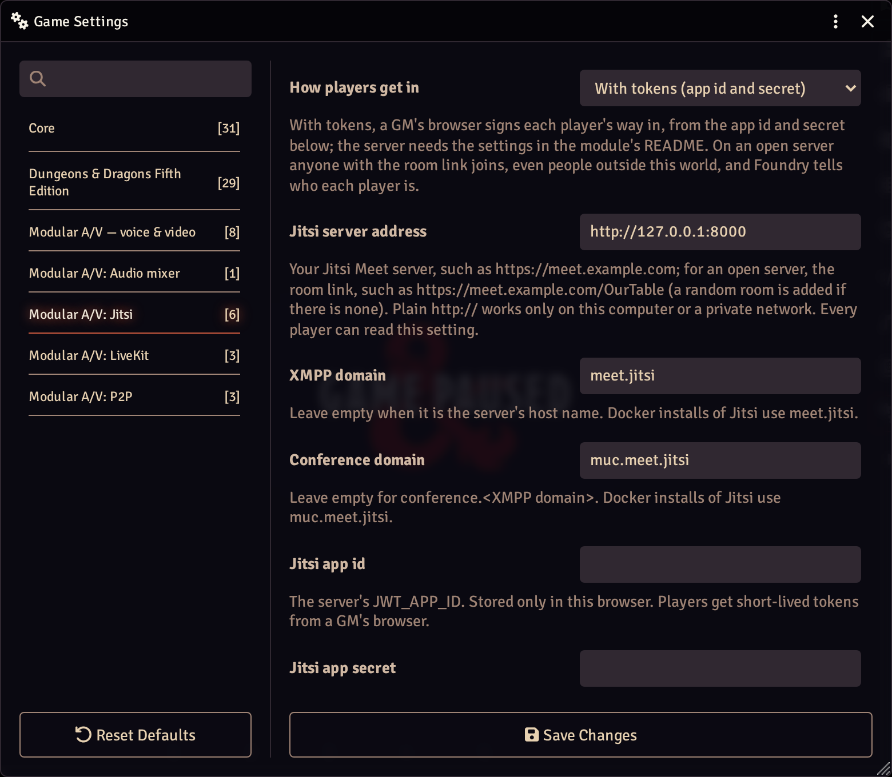

# Modular A/V: Jitsi

<a href="https://github.com/Affid/modular-av/tree/stats">
<picture>
  <source media="(prefers-color-scheme: dark)" srcset="https://raw.githubusercontent.com/Affid/modular-av/stats/badge-modular-av-jitsi-dark.svg">
  
</picture>
</a>

Carries Modular A/V's calls over your own Jitsi Meet server. Requires
`modular-av`.

## Two ways in

- **With tokens**: the server checks a token that a GM's browser signs
  for each player. It takes some setting up on the server (below), and
  then the server itself vouches for every player, and nobody without a
  token gets into the room.
- **An open server**: anyone with the room link joins, as on a fresh
  docker-jitsi-meet or Debian install. Nothing to change on the server;
  you paste the room link and players join, even with no GM online.
  Foundry vouches for each player instead of the server, and anyone who
  has the link can still join the room (see [An open
  server](#an-open-server)).

## A server with tokens

A self-hosted Jitsi Meet (tested with docker-jitsi-meet `stable-11248-2`)
with:

- **Token (JWT) authentication** with an app id and secret, and no
  guests: in docker-jitsi-meet, `ENABLE_AUTH=1`, `AUTH_TYPE=jwt`,
  `JWT_APP_ID`, `JWT_APP_SECRET`, `JWT_ALLOW_EMPTY=0` and `ENABLE_GUESTS=0`.
- **Prosody's `presence_identity` module on the main VirtualHost**, so
  the server tells everyone who each participant is, from their token
  (in docker-jitsi-meet, `XMPP_MODULES=presence_identity`). It isn't on
  in any of Jitsi's default setups. It is a security requirement, not
  only a working one: it is what stops a modified client from claiming to
  be another player. Without it nobody appears in the call (this module's
  clients send no identity of their own), and the console says why.
- **No moderator rights for players.** A Jitsi server with tokens makes
  everyone a moderator by default, and a moderator's client can mute or
  remove others. Let the token decide instead: Prosody's
  `token_affiliation` module on the conference component, and Jicofo
  neither handing out ownership nor running its own authentication (in
  docker-jitsi-meet, `XMPP_MUC_MODULES=token_affiliation`,
  `ENABLE_AUTO_OWNER=0` and `JICOFO_ENABLE_AUTH=0`; Prosody still checks
  every token). The tokens this module signs grant no moderator rights,
  and the console warns when the server makes a player one anyway.
- Its XMPP WebSocket (`/xmpp-websocket`) reachable from players'
  browsers, which open it from Foundry's address.

meet.jit.si and 8x8's Jitsi as a Service aren't supported: meet.jit.si
gives its sign-in tokens only to its own pages, and JaaS's terms for a
module like this one haven't been checked.

## An open server

A self-hosted Jitsi Meet that lets anyone with a link in, which is how
docker-jitsi-meet and the Debian packages set themselves up. Its XMPP
WebSocket (`/xmpp-websocket`) must be reachable from players' browsers,
which open it from Foundry's address. Servers run by others may refuse
connections from another site's pages, and have their own terms: ask
their owners first.

- **Who is who.** The server vouches for nobody, so Foundry does. Each
  player's browser names its Foundry user in its Jitsi presence, and
  claims its place in the room over Foundry's own socket, where
  Foundry's server names the sender. A place in the room is a player's
  only when both name them: a modified client can't take another
  player's place, and nobody outside the world gets one.
- **Who else can be in the room.** Anyone who has the room link. They
  get no tile in Foundry, but the server sends them everyone's sound and
  video all the same, so keep the link private. When someone in the room
  isn't in the world, GMs see a notice after a minute and a half (a
  player's closed or reloaded page stays in the room for a minute, and
  isn't taken for a stranger). A long random room, as the
  module makes when the link has none, can't be guessed.
- **Moderators.** An open server makes the first one in the room its
  moderator, and a moderator's client can mute or remove others. This
  module never does; a modified client, or someone joining from Jitsi's
  own page, could.
- **Room names.** Letters, digits, `-` and `_`; Jitsi folds them to lower
  case, as its own page does. Other names would end up in a different
  room from Jitsi's page, so the module refuses them. A name you choose,
  such as `OurTable`, is easy to guess: leave the room out of the link and
  the module makes one that isn't. The last part of the link is always
  read as the room, so for a site under a path, such as
  `https://example.com/jitsi`, give the room too:
  `https://example.com/jitsi/OurTable`.
- **Jitsi's own page.** Someone who opens the room link in a browser
  joins the same room, sees the players without their names, and is an
  outsider to Foundry, as above.

## Setting it up

1. In this module's settings, as a GM:
   - **How players get in** (world): with tokens, or an open server.
   - **Jitsi server address** (world): `https://meet.example.com`. For an
     open server, the room link instead, such as
     `https://meet.example.com/OurTable`; without a room, a random one is
     added when you save, and the room comes off again when you go back to
     tokens. A sign-in token in a pasted link is taken out,
     since every player can read this setting. Plain `http://` works only
     on your own computer or a private network.
   - **XMPP domain** and **conference domain** (world): leave them empty
     when they follow the address (`meet.example.com`,
     `conference.meet.example.com`). Docker installs use `meet.jitsi` and
     `muc.meet.jitsi`; for an open server, those are tried by themselves
     when the address's own name doesn't work.
   - **Jitsi app id** and **secret** (this browser only, tokens only): the
     server's `JWT_APP_ID` and `JWT_APP_SECRET`. Enter them in each
     browser a GM uses to run the game. They hide while an open server is
     chosen.
2. In Modular A/V's settings, choose Jitsi as the service.

## How players join

On an open server, a player's browser joins the room by itself, with no
token, so players join and reconnect whether or not a GM is online.

With tokens, the secret never leaves the GM's browser. A player's browser asks a GM's
for a token; the GM's browser signs a short-lived one for that player
alone and this world's room, with no moderator rights and no name (names
shown in Foundry come from Foundry). So a GM must be online for players
to join or reconnect, as they would be for a session. When a token runs
out during a long call, the player's browser gets a fresh one the same
way, without leaving the call.

## What's different from LiveKit

- Jitsi's tokens can't limit what a player sends, so a GM's block is
  enforced by everyone else's browser, which refuses that player's
  audio or video (and asks the server not to send it), as with P2P.
- Every call goes through the server, even for two players (Jitsi's own
  peer-to-peer mode is off).
- Who is speaking comes from each player's own voice detection, shared
  over Foundry.
- A shared screen arrives without its sound: Jitsi carries one sound
  track per player, their microphone.
- End-to-end encryption, the lobby, recording and transcription aren't
  supported.
- Servers much older or newer than the tested one may not work: Jitsi
  publishes no rule for which versions of its client and server work
  together.

The browser talks only to your Jitsi server: lib-jitsi-meet's analytics,
statistics and log collection stay off. Like LiveKit's, Jitsi's client
puts the token in the WebSocket's address, so it can show in that
browser's console and in your server's logs while it is valid (ten
minutes): don't log query strings on the server or its proxy.

## Inside this package

For someone reading the code. How the modules fit together is in
[docs/ARCHITECTURE.md](../../docs/ARCHITECTURE.md).

- **What it adds**: one service, registered with the core inside the
  `modularAV.register` hook, and its Foundry settings: how players get
  in, the server's address and domains (world) and the app id and secret
  (this browser only).
- **How it works**: `src/token.ts` signs a player's token in the GM's
  browser. `src/connection.ts`, `src/join.ts` and
  `src/conference-events.ts` wrap a lib-jitsi-meet conference in the
  core's `ServiceConnection`. On an open server, `src/binding.ts` tells
  who is who from each participant's presence and their claim on the
  core's socket (`src/binding-messages.ts` checks every claim), and
  `src/outsiders.ts` tells of people in the room whom nobody vouches
  for. `src/open-link.ts` reads a room link, `src/server-address.ts` the
  settings into a server, and `src/saved-address.ts` keeps the address
  free of tokens. `src/sdk.ts` starts lib-jitsi-meet with its analytics,
  statistics and log collection off and its own ids kept in memory.
- **Code**: about 3,000 lines in 26 files. The entry file is held under
  10 KB; lib-jitsi-meet loads when a call starts, the token code when a
  GM's browser signs one.
- **Third-party code**: lib-jitsi-meet v2205.0.0 (Apache-2.0),
  unmodified. It is downloaded at build time from Jitsi's own GitHub
  release and checked against a fixed SHA-256 hash (`package.json`,
  `modularAV.downloads`), and ships in the module's zip.
- **Network**: the Jitsi server the GM entered, and nothing else. On an
  open server, each player's claim (their place in the Jitsi room) goes
  over Foundry's own socket. **Storage**: how players get in and the
  address in world settings; the app id and secret in the GM's browser.
- **Tests**: 13 unit test files (`pnpm vitest run packages/jitsi`) and 5
  in a real browser (`pnpm playwright test packages/jitsi`). They
  include the shared service contract from `@modular-av/testing`, which
  also runs against two real Jitsi Meets in Docker, one with tokens and
  one open (`pnpm test:services`), and checks that a page naming another
  player, or someone outside the world, gets no place.

### Upgrading lib-jitsi-meet

The module relies on how this version behaves inside, beyond its public
API. Before changing the version in `package.json`
(`modularAV.downloads`), check these against the new source, then run
`pnpm test:services` against the Docker Jitsi server.

- **Two private methods** (`src/local-tracks.ts`):
  `conference._removeLocalTrackFromPc(track)` and
  `track._sendMuteStatus(true)`. lib-jitsi-meet names a video by its
  place among those sent, so a camera removed during a share breaks the
  share's name and comes back under it. The module keeps the camera's
  place instead, the way the library mutes a camera of its own. Its
  public `mute()` can't be used: it stops the core's track.
- **A removed video stays, signalled as muted**
  (`src/conference-events.ts`): the others get no `TRACK_REMOVED`, so
  a remote video that turns muted is reported as gone, and as back when
  it is unmuted.
- **A removal is only announced for a live track**
  (`src/local-tracks.ts`): the track leaves the conference before its
  stream is emptied.

The contract test "carries a screen share and its sound apart from the
camera" covers all three: it stops a share, shares again, and turns the
camera off and on during the share.

## Licence

MIT. Ships lib-jitsi-meet unmodified (Apache-2.0); see its notices.
