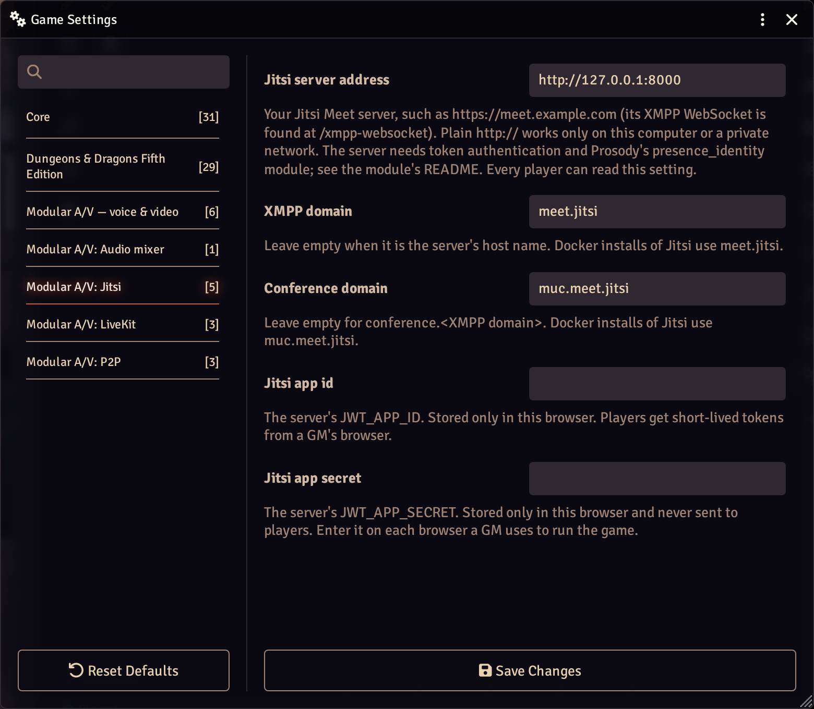

# Modular A/V: Jitsi

Carries Modular A/V's calls over your own Jitsi Meet server, with token
authentication. Requires `modular-av`.

## What your Jitsi server needs

A self-hosted Jitsi Meet (tested with docker-jitsi-meet `stable-11248-2`)
with:

- **Token (JWT) authentication** with an app id and secret, and no
  guests: in docker-jitsi-meet, `ENABLE_AUTH=1`, `AUTH_TYPE=jwt`,
  `JWT_APP_ID`, `JWT_APP_SECRET`, `JWT_ALLOW_EMPTY=0` and `ENABLE_GUESTS=0`.
- **Prosody's `presence_identity` module on the main VirtualHost**, so
  the server tells everyone who each participant is, from their token
  (in docker-jitsi-meet, `XMPP_MODULES=presence_identity`). It isn't on
  in any of Jitsi's default setups. It is a security requirement, not
  only a working one: it is what stops a modified client from claiming to
  be another player. Without it nobody appears in the call (this module's
  clients send no identity of their own), and the console says why.
- **No moderator rights for players.** A Jitsi server with tokens makes
  everyone a moderator by default, and a moderator's client can mute or
  remove others. Let the token decide instead: Prosody's
  `token_affiliation` module on the conference component, and Jicofo
  neither handing out ownership nor running its own authentication (in
  docker-jitsi-meet, `XMPP_MUC_MODULES=token_affiliation`,
  `ENABLE_AUTO_OWNER=0` and `JICOFO_ENABLE_AUTH=0`; Prosody still checks
  every token). The tokens this module signs grant no moderator rights,
  and the console warns when the server makes a player one anyway.
- Its XMPP WebSocket (`/xmpp-websocket`) reachable from players'
  browsers, which open it from Foundry's address.

meet.jit.si and 8x8's Jitsi as a Service aren't supported: meet.jit.si
gives its sign-in tokens only to its own pages, and JaaS's terms for a
module like this one haven't been checked.

## Setting it up

1. In this module's settings, as a GM:
   - **Jitsi server address** (world): `https://meet.example.com`. Plain
     `http://` works only on your own computer or a private network.
   - **XMPP domain** and **conference domain** (world): leave them empty
     when they follow the address (`meet.example.com`,
     `conference.meet.example.com`). Docker installs use `meet.jitsi` and
     `muc.meet.jitsi`.
   - **Jitsi app id** and **secret** (this browser only): the server's
     `JWT_APP_ID` and `JWT_APP_SECRET`. Enter them in each browser a GM
     uses to run the game.
2. In Modular A/V's settings, choose Jitsi as the service.

## How players join

The secret never leaves the GM's browser. A player's browser asks a GM's
for a token; the GM's browser signs a short-lived one for that player
alone and this world's room, with no moderator rights and no name (names
shown in Foundry come from Foundry). So a GM must be online for players
to join or reconnect, as they would be for a session. When a token runs
out during a long call, the player's browser gets a fresh one the same
way, without leaving the call.

## What's different from LiveKit

- Jitsi's tokens can't limit what a player sends, so a GM's block is
  enforced by everyone else's browser, which refuses that player's
  audio or video (and asks the server not to send it), as with P2P.
- Every call goes through the server, even for two players (Jitsi's own
  peer-to-peer mode is off).
- Who is speaking comes from each player's own voice detection, shared
  over Foundry.
- A shared screen arrives without its sound: Jitsi carries one sound
  track per player, their microphone.
- End-to-end encryption, the lobby, recording and transcription aren't
  supported.
- Servers much older or newer than the tested one may not work: Jitsi
  publishes no rule for which versions of its client and server work
  together.

The browser talks only to your Jitsi server: lib-jitsi-meet's analytics,
statistics and log collection stay off. Like LiveKit's, Jitsi's client
puts the token in the WebSocket's address, so it can show in that
browser's console and in your server's logs while it is valid (ten
minutes): don't log query strings on the server or its proxy.

## Inside this package

For someone reading the code. How the modules fit together is in
[docs/ARCHITECTURE.md](../../docs/ARCHITECTURE.md).

- **What it adds**: one service, registered with the core inside the
  `modularAV.register` hook, and its Foundry settings: the server's
  address and domains (world) and the app id and secret (this browser
  only).
- **How it works**: `src/token.ts` signs a player's token in the GM's
  browser. `src/connection.ts`, `src/join.ts` and
  `src/conference-events.ts` wrap a lib-jitsi-meet conference in the
  core's `ServiceConnection`. `src/sdk.ts` starts lib-jitsi-meet with
  its analytics, statistics and log collection off and its own ids kept
  in memory.
- **Code**: about 2,000 lines in 19 files. The entry file is held under
  10 KB; lib-jitsi-meet loads when a call starts.
- **Third-party code**: lib-jitsi-meet v2205.0.0 (Apache-2.0),
  unmodified. It is downloaded at build time from Jitsi's own GitHub
  release and checked against a fixed SHA-256 hash (`package.json`,
  `modularAV.downloads`), and ships in the module's zip.
- **Network**: the Jitsi server the GM entered, and nothing else.
  **Storage**: the address in world settings; the app id and secret in
  the GM's browser.
- **Tests**: 10 unit test files (`pnpm vitest run packages/jitsi`) and 3
  in a real browser (`pnpm playwright test packages/jitsi`). They
  include the shared service contract from `@modular-av/testing`, which
  also runs against a real Jitsi Meet in Docker (`pnpm test:services`).

### Upgrading lib-jitsi-meet

The module relies on how this version behaves inside, beyond its public
API. Before changing the version in `package.json`
(`modularAV.downloads`), check these against the new source, then run
`pnpm test:services` against the Docker Jitsi server.

- **Two private methods** (`src/local-tracks.ts`):
  `conference._removeLocalTrackFromPc(track)` and
  `track._sendMuteStatus(true)`. lib-jitsi-meet names a video by its
  place among those sent, so a camera removed during a share breaks the
  share's name and comes back under it. The module keeps the camera's
  place instead, the way the library mutes a camera of its own. Its
  public `mute()` can't be used: it stops the core's track.
- **A removed video stays, signalled as muted**
  (`src/conference-events.ts`): the others get no `TRACK_REMOVED`, so
  a remote video that turns muted is reported as gone, and as back when
  it is unmuted.
- **A removal is only announced for a live track**
  (`src/local-tracks.ts`): the track leaves the conference before its
  stream is emptied.

The contract test "carries a screen share and its sound apart from the
camera" covers all three: it stops a share, shares again, and turns the
camera off and on during the share.

## Licence

MIT. Ships lib-jitsi-meet unmodified (Apache-2.0); see its notices.
