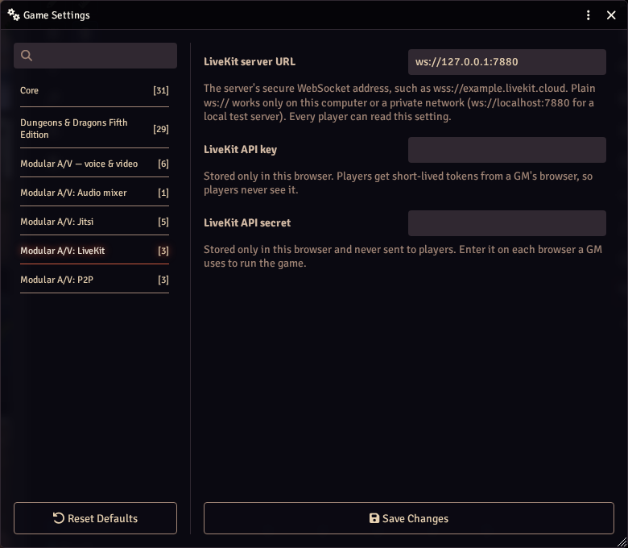

# Modular A/V: LiveKit

Carries Modular A/V's calls over a LiveKit server: your own or LiveKit
Cloud. Requires `modular-av`.

## Setting it up

1. Create a project on LiveKit Cloud, or run your own LiveKit server.
2. In this module's settings, as a GM:
   - **LiveKit server URL** (world): `wss://…`. Plain `ws://` works only on
     your own computer or a private network.
   - **LiveKit API key** and **secret** (this browser only): enter them in
     each browser a GM uses to run the game.
3. In Modular A/V's settings, choose LiveKit as the service.

## How players join

The secret never leaves the GM's browser. A player's browser asks a GM's
for a token; the GM's browser signs a short-lived one for that player
alone, for this world's room, allowed to send only what the GM's
permissions allow. So a GM must be online for players to join or
reconnect, as they would be for a session; the dock says "waiting for
the GM" meanwhile.

Coming from LiveKit AVClient, which kept the secret where every player
could read it: the first time a GM opens the world, this module offers
to bring the old server over and to remove the old setting. Replace your
key afterwards; see [Moving from LiveKit AVClient](https://github.com/Affid/modular-av/wiki/Moving-from-LiveKit-AVClient).

## Inside this package

For someone reading the code. How the modules fit together is in
[docs/ARCHITECTURE.md](../../docs/ARCHITECTURE.md).

- **What it adds**: one service, registered with the core inside the
  `modularAV.register` hook, and its Foundry settings: the server URL
  (world) and the API key and secret (this browser only).
- **How it works**: `src/token.ts` signs a player's token in the GM's
  browser with the browser's own crypto. `src/connection.ts` and
  `src/room-events.ts` wrap a `livekit-client` room in the core's
  `ServiceConnection`: connect, publish the tracks the core hands over,
  report what arrives. Mute, blocks and reconnecting are the core's.
- **Code**: about 1,200 lines in 17 files. The entry file is held under
  20 KB; `livekit-client` loads when a call starts.
- **Third-party code**: `livekit-client` 2.22.4 (Apache-2.0), bundled.
- **Network**: the LiveKit server the GM entered, and nothing else.
  **Storage**: the server URL in a world setting; the key and secret in
  the GM's browser, never in a world setting.
- **Tests**: 9 unit test files (`pnpm vitest run packages/livekit`) and
  1 in a real browser (`pnpm playwright test packages/livekit`). They
  include the shared service contract from `@modular-av/testing`, which
  also runs against a real LiveKit server in Docker (`pnpm
test:services`).

## Licence

MIT. Bundles `livekit-client` (Apache-2.0); see its notices.
